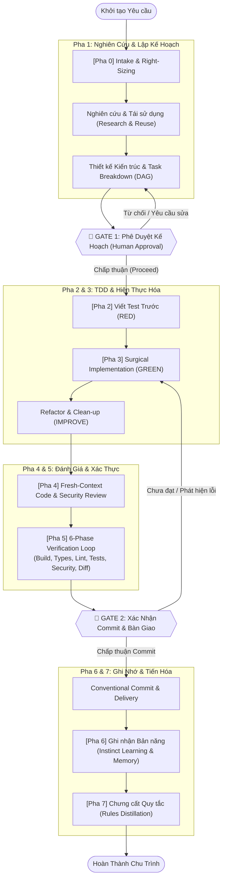

# Quy Trình Phát Triển Ứng Dụng Chuẩn Công Nghiệp (ECC-Integrated Lifecycle)

Kỹ năng này định nghĩa quy trình công nghệ phần mềm chuẩn công nghiệp (Industrial Software Development Lifecycle), được tích hợp toàn diện từ kiến trúc của **ECC** ([affaan-m/ecc](https://github.com/affaan-m/ecc) - *Everything Claude Code / Enterprise-grade Coding Companion*), tối ưu hóa dành riêng cho môi trường Agentic AI Assistant và các dự án phát triển hiện đại.

Mục tiêu tối thượng: **Loại bỏ tình trạng AI code mò mẫm, sinh code không kiểm soát, phá vỡ kiến trúc hoặc rò rỉ lỗ hổng bảo mật.** Mọi thay đổi mã nguồn đều phải tuân theo chu trình khép kín:
$$\text{Plan} \longrightarrow \text{Test (TDD)} \longrightarrow \text{Implement} \longrightarrow \text{Review} \longrightarrow \text{Verify} \longrightarrow \text{Remember} \longrightarrow \text{Improve}$$

---

## 🏗️ 1. Bản Đồ Vòng Đời Kỹ Thuật Tổng Thể (The Lifecycle)



---

## ⚖️ 2. Hệ Thống Phân Loại Quy Mô Tác Vụ (Right-Sizing Tiers)

Không phải tác vụ nào cũng cần toàn bộ nghi thức nặng nề. ECC quy định hệ thống đánh giá **Right-Sizing** dựa trên bán kính ảnh hưởng (*blast radius*):

| Cấp độ (Tier) | Tiêu chí Định lượng | Ảnh hưởng Hợp đồng / Phụ thuộc | Sự mơ hồ Thiết kế | Các Pha Bắt Buộc | Chốt chặn (Gates) |
| :--- | :--- | :--- | :--- | :--- | :--- |
| **Trivial** | 1 file, $\le 10$ dòng code | Không có phụ thuộc mới | Yêu cầu hoàn toàn rõ ràng | Implement $\rightarrow$ Verify | Gate 2 |
| **Small** | 1 file / 1 hàm logic | Không đổi public contract | Rõ ràng sau khi đọc code | (Research nhẹ) $\rightarrow$ TDD $\rightarrow$ Verify | Gate 2 |
| **Standard** | 2 – 5 files | Module nội bộ mới | Có 1 đánh đổi thiết kế cụ thể | Research $\rightarrow$ Plan $\rightarrow$ TDD $\rightarrow$ Review $\rightarrow$ Verify | **Gate 1 + Gate 2** |
| **Large** | Nhiều files, liên module | Public API, dependency mới, DB migration | Nhiều phương án kiến trúc mở | Toàn bộ 7 Pha + ADR + MVP Spike | **Gate 1 + Gate 2** |

> [!IMPORTANT]
> **Quy tắc Phá vỡ (Tie-Breaker Rule):** Bất kỳ thay đổi nào liên quan đến **Bảo mật** (Authentication, Authorization, Cryptography, Token handling) hoặc **Public API Contract** đều bắt buộc xếp từ mức **Standard** trở lên, bất kể số lượng file thay đổi ít hay nhiều.

---

## 🚦 3. Chi Tiết 7 Giai Đoạn Vận Hành Chuẩn (Standard Operational Runbook)

### Giai Đoạn 0 & 1: Tiếp Nhận, Nghiên Cứu & Lập Kế Hoạch (Research & Plan)

> **Mục tiêu**: Lập bản đồ tác vụ tường minh, không bao giờ viết code khi chưa có kế hoạch được phê duyệt.

1. **Nghiên cứu & Tái sử dụng (Research & Reuse First - Nguyên tắc ECC)**:
   - **Tìm kiếm mã nguồn đã có**: Kiểm tra codebase hiện tại và các thư viện mã nguồn mở uy tín trước khi viết mới. Tránh phát minh lại bánh xe (*reinventing the wheel*).
   - **Tra cứu tài liệu chuẩn (Official Docs / Context)**: Sử dụng tài liệu chính thức của framework/ngôn ngữ để xác minh API và compatibility.
   - **Đánh giá thư viện hệ sinh thái**: Ưu tiên thư viện chuẩn, đã qua thử nghiệm thực chiến thay vì tự viết tiện ích thô.
2. **Lập Kế hoạch Thực thi (Execution Plan)**:
   - Soạn thảo tài liệu kế hoạch với định dạng Artifact (`*.plan.md`).
   - Phân tích rủi ro kỹ thuật, các điểm phụ thuộc (*dependencies*), và chia nhỏ thành Đồ thị tác vụ có hướng không chu trình (**DAG - Directed Acyclic Graph**).
   - Định nghĩa trước các **Điều kiện Nghiệm thu (Acceptance Criteria)** đo lường được.

---

### 🚪 CHỐT CHẶN 1 (GATE 1) — Phê Duyệt Kế Hoạch (Plan Approval)

> **Quy tắc cốt lõi:** Dừng lại, trình bày kế hoạch rõ ràng và chờ sự đồng ý của con người. Tuyệt đối **KHÔNG ĐƯỢC** bắt đầu can thiệp mã nguồn khi người dùng chưa bấm nút xác nhận hoặc đồng ý triển khai.

---

### Giai Đoạn 2: Phát Triển Hướng Kiểm Thử (TDD — Test-Driven Development)

> **Mục tiêu**: Đảm bảo mọi dòng code sinh ra đều có mục đích rõ ràng và được bảo vệ bởi test suite.

Chu trình 3 bước TDD kinh điển:
1. **RED (Viết Test Thất Bại)**:
   - Viết test case mô tả chính xác hành vi mong muốn trước khi hiện thực logic.
   - Chạy test suite và chứng minh test thất bại với lý do chính đáng (*Expected Failure*).
2. **GREEN (Hiện thực Mã nguồn Tối thiểu)**:
   - Viết lượng code tối thiểu cần thiết để test case chuyển sang màu xanh (PASS).
   - Tránh over-engineering hoặc hiện thực dư thừa tính năng ngoài phạm vi test.
3. **IMPROVE / REFACTOR (Tối ưu & Tinh gọn)**:
   - Tối ưu hóa cấu trúc code, loại bỏ trùng lặp, cải thiện đặt tên nhưng **bảo đảm test luôn xanh**.
   - **Chỉ tiêu chất lượng**: Đạt độ phủ kiểm thử tối thiểu $\ge 80\%$ (bao gồm Unit test, Integration test và Edge cases).

---

### Giai Đoạn 3: Hiện Thực Hóa Chuẩn Xác (Surgical & Clean-Room Implementation)

Khi viết mã nguồn thực tế, bắt buộc tuân thủ 5 nguyên lý công nghiệp của ECC:

1. **Tính Bất Biến (Immutability by Default)**:
   - Luôn ưu tiên tạo đối tượng mới thay vì biến đổi trực tiếp trên đối tượng cũ (*in-place mutation*), ngăn chặn tác dụng phụ ngoài ý muốn (*unintended side-effects*).
2. **Kiểu Dữ Liệu Tường Minh (Strict Type Safety)**:
   - Khai báo kiểu dữ liệu đầy đủ cho tất cả tham số hàm, thuộc tính và giá trị trả về. Không dùng kiểu tự do thiếu kiểm soát (`any`, `Object` vô định).
3. **Báo Lỗi Sớm & Rõ Ràng (Fail Loudly & Early)**:
   - Kiểm tra điều kiện tiên quyết ở ranh giới đầu vào (*Boundary Validation*). Ném ngoại lệ với thông điệp ngữ cảnh rõ ràng thay vì nuốt lỗi âm thầm (`try ... except: pass`).
4. **Giữ Tệp Nhỏ & Đơn Trách Nhiệm (Single Responsibility & Cohesion)**:
   - Mỗi file đảm nhiệm một vai trò duy nhất. Tách nhỏ các hàm dài dòng (>50 dòng) thành các hàm con thuần túy (*pure functions*).
5. **Giới Hạn Tác Động Phẫu Thuật (Surgical Diffs)**:
   - Chỉ sửa đổi các dòng code phục vụ trực tiếp cho tác vụ hiện tại. Không format lại cả file hoặc sửa code không liên quan gây ô nhiễm git diff.

---

### Giai Đoạn 4: Đánh Giá Đa Chiều & An Ninh (Fresh-Context Review & AgentShield)

Trước khi coi một tác vụ là hoàn thành, tiến hành đánh giá phản biện từ góc nhìn độc lập (*fresh-context perspective*):

#### Bộ Tiêu Chuẩn An Ninh AgentShield Baseline:
- [ ] **Quản lý Bí mật (Secrets Zero-Tolerance)**: Tuyệt đối không hardcode API Key, mật khẩu, private key, token vào mã nguồn. Mọi thông tin nhạy cảm phải nạp qua biến môi trường (`.env`).
- [ ] **Làm sạch Đầu vào (Input Sanitization & Validation)**: Kiểm tra kiểu dữ liệu, độ dài, định dạng regex ở mọi ranh giới (API endpoint, CLI input, Webhook).
- [ ] **Chống Tấn công Tiêm nhiễm (Injection Prevention)**: Bắt buộc dùng tham số hóa câu truy vấn (Parameterized Queries / ORM). Tuyệt đối không nối chuỗi SQL/Shell thô.
- [ ] **Kiểm soát Truy cập & Phân quyền (Authn / Authz)**: Kiểm tra phân quyền ở cấp độ dữ liệu (*Row-level security / Object-level permissions*).
- [ ] **Che giấu Dấu vết Nội bộ (Safe Error Propagation)**: Lỗi trả về cho client/user không được làm lộ stack trace, thông tin hệ điều hành hay cấu trúc database.

---

### Giai Đoạn 5: Vòng Lặp Xác Thực 6 Pha (The 6-Phase Verification Loop)

Chạy bộ kiểm tra tự động toàn diện trước khi bàn giao:

```
+-----------------------------------------------------------------------------------+
|                        THE 6-PHASE VERIFICATION SUITE                             |
+-----------------------------------------------------------------------------------+
|  [Pha 1] BUILD VERIFICATION     : Biên dịch/đóng gói thành công không lỗi cú pháp|
|  [Pha 2] TYPE CHECK             : Trình kiểm tra kiểu (tsc, pyright, mypy) 0 lỗi |
|  [Pha 3] LINTING & FORMATTING   : Tuân thủ linter (ruff, eslint, flake8)          |
|  [Pha 4] TEST SUITE & COVERAGE  : Toàn bộ test PASS; Độ phủ đạt >= 80%           |
|  [Pha 5] SECURITY SCAN          : Quét lỗ hổng bí mật & mã độc (gitleaks, grep)  |
|  [Pha 6] DIFF INSPECTION        : Kiểm duyệt lại toàn bộ diff trước khi commit   |
+-----------------------------------------------------------------------------------+
```

---

### 🚪 CHỐT CHẶN 2 (GATE 2) — Xác Nhận Commit & Bàn Giao (Delivery Gate)

> **Quy tắc cốt lõi:** Trình bày tóm tắt toàn bộ thay đổi (Diff Summary), danh sách các bài test đã pass, và đề xuất thông điệp commit theo chuẩn **Conventional Commits**. Chờ người dùng xác nhận trước khi thực hiện commit/push.

Định dạng Conventional Commit chuẩn:
```text
<type>(<scope>): <mô tả ngắn gọn, súc tích>

[Mô tả chi tiết lý do thay đổi, giải pháp kỹ thuật]

Breaking Changes (nếu có):
- Mô tả thay đổi phá vỡ tương thích
```
Các `type` chuẩn: `feat`, `fix`, `refactor`, `test`, `docs`, `perf`, `chore`, `ci`.

---

### Giai Đoạn 6 & 7: Ghi Nhớ Bản Năng & Tiến Hóa (Remember & Improve)

Quy trình phát triển không dừng lại ở việc commit code, mà là sự tích lũy tri thức cho các phiên làm việc tiếp theo:

1. **Ghi nhận Bản năng (Instinct Learning - ECC v2.1 Model)**:
   - Khi phát hiện một giải pháp tối ưu, một cạm bẫy đặc thù của dự án, hoặc sự điều chỉnh quan trọng từ người dùng, lập tức đúc kết thành **Bản năng nguyên tử (Atomic Instinct)**:
     ```yaml
     id: project-specific-sqlite-wal-mode
     trigger: "khi thiết lập database SQLite cho môi trường concurrency"
     confidence: 0.85
     domain: "database-performance"
     scope: project
     rule: "Luôn kích hoạt PRAGMA journal_mode=WAL và synchronous=NORMAL để tránh deadlock luồng."
     ```
2. **Ghi chép Quyết định Kiến trúc (ADR - Architecture Decision Records)**:
   - Các quyết định lớn về mặt kỹ thuật phải được ghi nhận vào `docs/adr/` theo chuẩn: Bối cảnh $\rightarrow$ Quyết định $\rightarrow$ Hậu quả/Đánh đổi.
3. **Chưng cất Quy tắc (Rules Distillation)**:
   - Định kỳ tổng hợp các bài học sau nhiều phiên làm việc để tinh gọn vào tập quy tắc chung của dự án, giúp toàn bộ hệ thống ngày càng chuẩn hóa và tinh gọn.

---

## 👥 4. Ma Trận Phân Quyền & Điều Phối Đặc Vụ (Agent Orchestration Matrix)

ECC tổ chức mô hình phân vai rành mạch, tối ưu hóa ngữ cảnh và chuyên môn hóa sâu:

| Vai Trò Đặc Vụ (Role) | Chuyên Trách & Nhiệm Vụ | Thời Điểm Kích Hoạt |
| :--- | :--- | :--- |
| **`planner`** | Phân rã bài toán, lập DAG task, phân tích rủi ro | Bắt đầu tính năng mới, tái cấu trúc lớn |
| **`architect`** | Thiết kế hệ thống, phân tích trade-off, chọn công nghệ | Quyết định nền tảng, thiết kế cơ sở dữ liệu |
| **`tdd-guide`** | Hướng dẫn viết test RED $\rightarrow$ GREEN $\rightarrow$ REFACTOR | Bắt đầu viết tính năng hoặc sửa bug |
| **`code-reviewer`** | Đánh giá chất lượng code, độ phức tạp, tính dễ đọc | Ngay sau khi viết code xong |
| **`security-reviewer`** | Kiểm tra rò rỉ secret, input validation, SQLi, CSRF | Đụng chạm auth, db, network, crypto |
| **`build-error-resolver`** | Chẩn đoán và sửa lỗi biên dịch, xung đột kiểu dữ liệu | Khi build hoặc type-check thất bại |
| **`refactor-cleaner`** | Dọn dẹp dead code, tối ưu hàm dư thừa, chuẩn hóa tên gọi | Giai đoạn hậu kiểm tra (Post-implementation) |
| **`performance-optimizer`** | Phân tích profiling, memory leak, I/O bottleneck | Module tải cao, xử lý dữ liệu lớn |

---

## 📋 5. Biểu Mẫu Kế Hoạch Chuẩn (ECC Task Breakdown & DAG Template)

Mỗi khi khởi tạo kế hoạch cho tác vụ từ mức **Standard** trở lên, áp dụng mẫu sau:

```markdown
# [Tên Tính Năng / Nhiệm Vụ]: Implementation Plan

## 1. Mục Tiêu & Phân Loại Quy Mô
- **Quy mô (Right-sizing)**: [Standard / Large]
- **Tóm tắt mục tiêu**: [Mô tả 1-2 câu]
- **Ranh giới tác động (Blast Radius)**: [Các module/files bị ảnh hưởng]

## 2. Tiêu Chuẩn Chấp Thuận (Acceptance Criteria)
- [ ] AC1: Hành vi chuẩn xác khi input hợp lệ
- [ ] AC2: Bắt lỗi và thông báo thân thiện khi input dị thường
- [ ] AC3: Test coverage đạt >= 80%

## 3. Đồ Thị Tác Vụ Phân Rã (Task DAG & Dependency Graph)
- [ ] **Task 1: [Research & Contract]** Xác định schemas, DTOs và Interfaces
- [ ] **Task 2: [TDD Suite]** Viết Unit Test cho tầng Core Domain (RED)
- [ ] **Task 3: [Implementation]** Hiện thực logic xử lý tầng Domain (GREEN)
- [ ] **Task 4: [Integration Test]** Viết test tích hợp kết nối I/O (Database/API)
- [ ] **Task 5: [Verification & Review]** Chạy 6-Phase Loop & Security Audit

## 4. Chốt Chặn An Ninh (AgentShield Security Considerations)
- Dữ liệu nhạy cảm cần bảo vệ: [Liệt kê]
- Phương thức validation: [Pydantic / Zod / Schemas]
- Chiến lược xử lý ngoại lệ: [Custom Exception Hierarchy]
```

---

## 🚫 6. Cảnh Báo Sai Lầm Cần Tránh (Anti-Patterns & Pitfalls)

| Sai lầm (Anti-Pattern) | Hậu quả Tai hại | Cách Khắc phục Chuẩn ECC |
| :--- | :--- | :--- |
| **Code trước, Nghĩ sau (Cowboy Coding)** | Lạc đề, phá vỡ cấu trúc có sẵn, tốn token | Bắt buộc qua Pha 0 & 1 và vượt qua **GATE 1** |
| **Bỏ qua TDD ("Sẽ viết test sau")** | Test bị bỏ quên, bug tiềm ẩn ở biên, test viết ra chỉ để đối phó | Luôn viết test RED trước khi gõ logic hàm |
| **Nuốt lỗi âm thầm (`except: pass`)** | Hệ thống chết đứng không dấu vết, debug mất nhiều ngày | Bắt đúng loại ngoại lệ, log đầy đủ ngữ cảnh, fail loudly |
| **Biến đổi dữ liệu trực tiếp (Mutable Mutation)** | Lỗi tương tranh luồng (race condition), cache stale | Tạo instance mới, ưu tiên immutable objects |
| **Ô nhiễm commit (Mega-Commit)** | Không thể `git bisect`, khó review, rủi ro conflict cao | Tách commit theo từng đơn vị logic, chuẩn Conventional Commits |
| **Bỏ quên tri thức phiên làm việc** | Lặp lại lỗi cũ ở các phiên tiếp theo | Đúc kết Atomic Instinct và cập nhật ADR/Memory |

---

## 📚 7. Thư Viện Tài Nguyên, Sổ Tay Vận Hành & Biểu Mẫu Đi Kèm

Hệ sinh thái kỹ năng phát triển ứng dụng bao gồm các tài liệu chuyên sâu và biểu mẫu chuẩn hóa sau:

### 📖 Sổ Tay & Tài Liệu Tham Chiếu Kỹ Thuật (References)
- **[Sổ Tay Vận Hành Tác Vụ Chuyên Biệt](file:///C:/Users/sonson/.gemini/config/skills/application-development-workflow/references/operation_runbooks.md)**: Quy trình chi tiết cho 5 loại tác vụ: Thêm tính năng (`orch-add-feature`), Sửa lỗi triệt để (`orch-fix-defect`), Tái cấu trúc (`orch-refine-code`), Điều chỉnh tính năng (`orch-change-feature`), và Khởi tạo MVP (`orch-build-mvp`).
- **[Kiến Trúc Cốt Lõi ECC](file:///C:/Users/sonson/.gemini/config/skills/application-development-workflow/references/ecc_core_principles.md)**: 5 trụ cột kỹ thuật, mô hình hàng đợi trách nhiệm phân tầng (Obligation Ledger) và danh mục an ninh AgentShield.
- **[Cơ Chế Học Tập Bản Năng & Ghi Nhớ](file:///C:/Users/sonson/.gemini/config/skills/application-development-workflow/references/continuous_learning_instincts.md)**: Định dạng Schema bản năng nguyên tử, thang điểm tin cậy (Confidence Scoring), và quy tắc chống ô nhiễm chéo dự án.
- **[Mô Hình Điều Phối Đặc Vụ Phụ (Subagents)](file:///C:/Users/sonson/.gemini/config/skills/application-development-workflow/references/subagent_orchestration_patterns.md)**: Phân vai chuyên môn hóa (Planner, Architect, TDD-Guide, Reviewer, Resolver) và giao thức ủy quyền không ô nhiễm context.
- **[Hàng Rào An Ninh & Cơ Chế Hooks](file:///C:/Users/sonson/.gemini/config/skills/application-development-workflow/references/guardrails_and_hooks.md)**: Danh mục lệnh cấm tuyệt đối, các hook tự động hóa (`PreToolUse`, `PostToolUse`, `PreCompact`) và bộ regex quét rò rỉ bí mật.

### 📝 Biểu Mẫu Chuẩn Hóa Dự Án (Templates)
- **[Biểu Mẫu Kế Hoạch Thực Thi (Implementation Plan)](file:///C:/Users/sonson/.gemini/config/skills/application-development-workflow/templates/plan_template.md)**: Mẫu lập DAG tác vụ, tiêu chuẩn nghiệm thu và chốt chặn Gate 1.
- **[Biểu Mẫu Báo Cáo Xác Thực 6 Pha (Verification Report)](file:///C:/Users/sonson/.gemini/config/skills/application-development-workflow/templates/verification_report.md)**: Mẫu báo cáo nghiệm thu Build, Types, Lint, Tests, Security, Diff và chốt chặn Gate 2.
- **[Biểu Mẫu Quyết Định Kiến Trúc (ADR)](file:///C:/Users/sonson/.gemini/config/skills/application-development-workflow/templates/adr_template.md)**: Mẫu lưu trữ quyết định kiến trúc dài hạn theo chuẩn Michael Nygard.
- **[Biểu Mẫu Hậu Kiểm & Phân Tích Gốc Rễ (Post-Mortem & RCA)](file:///C:/Users/sonson/.gemini/config/skills/application-development-workflow/templates/post_mortem_template.md)**: Mẫu điều tra sự cố, kỹ thuật 5-Whys, và đúc kết bản năng phòng ngừa.


