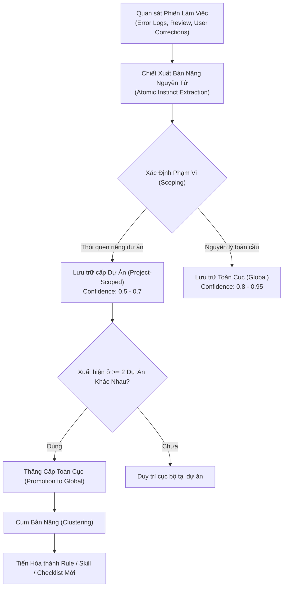

# Kiến Trúc Học Tập Bản Năng & Ghi Nhớ Liên Tục (ECC Instinct Learning & Memory)

Tài liệu này hướng dẫn chi tiết về cơ chế **Học tập Bản năng Nguyên tử (Atomic Instincts v2.1)** được kế thừa từ hệ thống ECC ([affaan-m/ecc](https://github.com/affaan-m/ecc)), giải quyết bài toán cốt lõi: **Làm thế nào để AI Agent tích lũy kinh nghiệm, không lặp lại sai lầm trong quá khứ mà không gây phình to ngữ cảnh (Context Bloat) hoặc ô nhiễm chéo giữa các dự án.**

---

## 🧠 1. Vấn Đề Của Cơ Chế Ghi Nhớ Truyền Thống

Trong các hệ thống AI thông thường:
1. **Lưu trữ toàn bộ lịch sử (Raw Transcripts)**: Tiêu tốn hàng chục ngàn token vô ích, làm giảm chất lượng suy luận của mô hình (*Lost in the Middle*).
2. **Ô nhiễm chéo (Cross-Project Contamination)**: Thói quen viết TypeScript/React bị áp đặt nhầm vào một dự án Python/PyQt5 hoặc Go.
3. **Mơ hồ không thể định lượng (Vague Memories)**: Những lời dặn chung chung như "hãy cẩn thận với database" không mang lại giá trị thực tế trong quá trình coding.

Hệ thống ECC giải quyết triệt để vấn đề này bằng mô hình **Bản Năng Nguyên Tử (Atomic Instincts)**.

---

## 🧬 2. Chu Trình Đời Sống Của Một Bản Năng (Instinct Lifecycle)



---

## 🏷️ 3. Định Dạng Chuẩn Bản Năng Nguyên Tử (YAML Schema)

Mỗi bản năng phải là một đơn vị tri thức độc lập, có thể kiểm chứng và áp dụng tức thì:

```yaml
---
id: pyqt-no-blocking-network-on-gui-thread
trigger: "khi gọi API HTTP, socket, hoặc đọc file lớn trong ứng dụng desktop PyQt5"
confidence: 0.9
domain: "gui-architecture"
scope: project
project_id: "sam-tienlen-2026"
tags:
  - pyqt5
  - threading
  - crash-prevention
rule: >
  Tuyệt đối không thực thi các tác vụ I/O chặn (blocking I/O) trên Main GUI Thread.
  Bắt buộc đẩy logic xử lý xuống QThread độc lập (Worker pattern) và giao tiếp
  qua pyqtSignal để tránh đóng băng giao diện (Application Not Responding - ANR).
anti_pattern: >
  def on_button_click(self):
      response = requests.get("https://api...") # GÂY ĐÓNG BĂNG GIAO DIỆN
      self.label.setText(response.text)
best_practice: >
  def on_button_click(self):
      self.worker = NetworkWorker(url)
      self.worker.finished.connect(self.on_data_ready)
      self.worker.start()
evidence: "Khắc phục hiện tượng Not Responding trong phiên làm việc ngày 29/10/2026"
```

---

## 🎯 4. Thang Điểm Tin Cậy (Confidence Scoring Matrix)

Điểm tin cậy phản ánh mức độ chắc chắn của bản năng và quyết định cách thức đặc vụ áp dụng nó:

| Điểm (Confidence) | Ý Nghĩa / Nguồn Gốc | Mức Độ Can Thiệp Của AI |
| :---: | :--- | :--- |
| **`0.3 - 0.4`** | **Phỏng đoán ban đầu (Hypothesis)**: Quan sát thấy 1 lần, chưa có sự xác nhận của người dùng. | Chỉ đóng vai trò gợi ý mềm, không tự ý áp đặt. |
| **`0.5 - 0.6`** | **Có bằng chứng thực nghiệm (Observed Pattern)**: Đã giải quyết thành công 1 sự cố cụ thể. | Áp dụng mặc định nhưng nêu rõ lý do trong phần giải thích. |
| **`0.7 - 0.8`** | **Được người dùng chuẩn hóa (User Validated)**: Người dùng trực tiếp yêu cầu hoặc đồng thuận trong review. | Áp dụng bắt buộc trong dự án hiện tại; xuất hiện ở bước lập Kế hoạch (DAG). |
| **`0.9 - 1.0`** | **Tiêu chuẩn công nghiệp bất biến (Ironclad Standard)**: Thử thách qua nhiều dự án hoặc là nguyên lý bảo mật tối thượng. | Trở thành quy tắc hệ thống (Global Rule), không cho phép vi phạm dưới bất kỳ hình thức nào. |

---

## 🛡️ 5. Cơ Chế Chống Ô Nhiễm Chéo (Anti-Contamination Protocol)

Để bảo đảm tính trong sạch của từng dự án:

1. **Nhận diện Dự án (Project Fingerprinting)**:
   - Dựa trên thư mục gốc VCS (`.git`), Git Remote URL hoặc file cấu hình nền tảng (`pyproject.toml`, `package.json`, `Cargo.toml`).
2. **Vách ngăn Cô lập (Project Sandboxing)**:
   - Bản năng của dự án frontend TypeScript không được nạp vào context khi làm việc với dự án backend C++/Rust.
3. **Quy tắc Thăng cấp Nghiêm ngặt (Strict Promotion Gate)**:
   - Một bản năng chỉ được đưa từ `project` lên `global` khi và chỉ khi:
     - Nó giải quyết một vấn đề trừu tượng phổ quát (e.g., input sanitization, error propagation, immutability).
     - Không chứa cú pháp, thư viện, hoặc giả định đặc thù của một framework đơn lẻ.
     - Đã được kiểm chứng hiệu quả độc lập trên ít nhất 2 dự án khác nhau.
