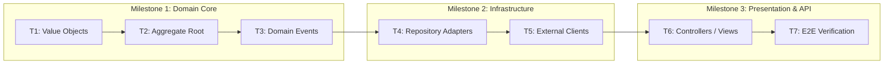

# ECC (Enterprise-grade Coding Companion) Core Architectural Reference

Tài liệu này đóng vai trò cẩm nang tham chiếu chi tiết về các nguyên tắc cốt lõi, mô hình tư duy và kiến trúc kỹ thuật của hệ thống **ECC** ([affaan-m/ecc](https://github.com/affaan-m/ecc)), hỗ trợ việc áp dụng nhất quán trong mọi dự án phát triển phần mềm.

---

## 1. Triết Lý Thiết Kế Cốt Lõi Của ECC

ECC được sinh ra để biến AI Assistant từ một chatbot rời rạc thành một **Đối tác Kỹ sư Phần mềm Chuyên nghiệp (Disciplined Engineering Partner)**. Hệ thống được xây dựng trên 5 trụ cột vững chắc:

```
+-----------------------------------------------------------------------------------+
|                           5 TRỤ CỘT CỐT LÕI CỦA ECC                               |
+-----------------------------------------------------------------------------------+
|  1. AGENT-FIRST      : Phân chia trách nhiệm rõ ràng cho các vai trò đặc vụ      |
|  2. TEST-DRIVEN      : Viết test trước code (TDD), độ phủ tối thiểu >= 80%        |
|  3. SECURITY-FIRST   : Không nhân nhượng an ninh; phòng thủ nhiều lớp             |
|  4. IMMUTABILITY     : Tạo mới dữ liệu thay vì sửa biến trạng thái (No Mutation)   |
|  5. PLAN-BEFORE-EXEC : Lập kế hoạch và duyệt rủi ro trước khi can thiệp code     |
+-----------------------------------------------------------------------------------+
```

---

## 2. Mô Hình Học Bản Năng Nguyên Tử (Atomic Instinct Model v2.1)

Trong ECC v2.1, cơ chế học tập liên tục (**Continuous Learning**) không lưu trữ tràn lan toàn bộ lịch sử chat, mà chưng cất thành các **bản năng nguyên tử (Atomic Instincts)**:

### Cấu Trúc Bản Năng (Instinct Schema)
```yaml
id: unique-kebab-case-identifier
trigger: "Điều kiện kích hoạt cụ thể (khi gặp bối cảnh nào)"
confidence: 0.1 - 1.0  # Mức độ tin cậy được tích lũy qua các phiên
domain: "code-style" | "architecture" | "testing" | "security" | "performance"
scope: "project" | "global"
project_id: "mã định danh dự án"
rule: "Chỉ dẫn hành vi dứt khoát, không mơ hồ"
evidence: "Tình huống thực tế hoặc commit/lỗi đã dẫn đến bài học này"
```

### Nguyên Tắc Quản Trị Bản Năng:
- **Phân tách phạm vi (Project-Scoped Isolation)**: Thói quen/quy tắc đặc thù của dự án nào thì nằm lại dự án đó, không làm ô nhiễm bộ nhớ toàn cục.
- **Tiến hóa (Promotion to Global)**: Khi một bản năng xuất hiện và được xác nhận hữu ích ở $\ge 2$ dự án khác nhau, nó được đề xuất thăng cấp lên phạm vi toàn cục (`global`).
- **Ngưỡng hành động (Confidence Gating)**:
  - `confidence < 0.5`: Cân nhắc, hỏi lại người dùng nếu gặp mâu thuẫn.
  - `confidence >= 0.7`: Tự động tuân thủ như một quy chuẩn nội bộ.

---

## 3. Bản Kê Trách Nhiệm Phân Cấp (Obligation Ledger & DAG)

Để ngăn chặn việc AI "quên việc" hoặc "nhảy cóc bước" khi làm dự án lớn, ECC sử dụng kỹ thuật **Hàng đợi Phân tầng (Staged Obligation Ledger)**:



- Không bao giờ chuyển sang Milestone tiếp theo nếu các bài kiểm tra của Milestone hiện tại chưa xanh (`GREEN`).
- Mỗi Milestone phải có một bản báo cáo bằng chứng (*Evidence Report*) gồm:
  - Mã bài test (RED evidence).
  - Kết quả chạy test pass (GREEN evidence).
  - Lượng code thay đổi (Diff size).

---

## 4. Danh Mục Kiểm Tra An Ninh AgentShield Toàn Diện

Mọi đoạn mã trước khi bàn giao phải được đối chiếu với danh mục phòng thủ này:

| Vùng Rủi Ro | Dấu Hiệu Vi Phạm (FAIL) | Chuẩn Công Nghiệp Bắt Buộc (PASS) |
| :--- | :--- | :--- |
| **API Keys & Secrets** | Ghi trực tiếp chuỗi `"sk-..."` vào code | Đọc từ `os.getenv` / `process.env` và assert sự tồn tại |
| **Database Queries** | Nối chuỗi `f"SELECT * FROM u WHERE id={uid}"` | Dùng Parameterized Query `("SELECT ... WHERE id = ?", (uid,))` |
| **File I/O Paths** | Mở đường dẫn từ client: `open(f"/tmp/{user_file}")` | Dùng `os.path.basename` + Whitelist thư mục cho phép |
| **Command Execution**| Gọi `shell=True` với tham số người dùng nhập | Dùng danh sách tham số cố định, không kích hoạt shell trung gian |
| **Error Handling** | In toàn bộ Exception traceback ra response client | Log traceback nội bộ với Log level ERROR; trả về mã lỗi chung cho client |
| **Network Calls** | `requests.get(url)` không có timeout | Luôn thiết lập `timeout=(3.05, 10.0)` và cơ chế retry có backoff |

