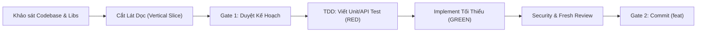
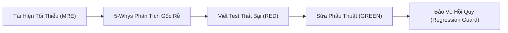

# Sổ Tay Vận Hành Tác Vụ Chuyên Biệt (ECC Operation Runbooks)

Tài liệu này cung cấp quy trình thực thi phẫu thuật cho 5 loại hình tác vụ kỹ thuật phổ biến nhất theo chuẩn ECC: **Thêm Tính Năng Mới**, **Sửa Lỗi (Defect Fixing)**, **Tái Cấu Trúc (Refactoring)**, **Điều Chỉnh Tính Năng (Feature Tweak)**, và **Khởi Tạo Dự Án MVP (Bootstrap)**.

---

## 🚀 1. Sổ Tay 1: Thêm Tính Năng Mới (orch-add-feature)

Áp dụng khi hệ thống cần bổ sung một năng lực hoặc hành vi chưa từng tồn tại trước đó.

### Quy Trình Thực Thi 5 Bước:
1. **Bước 1: Nghiên cứu ranh giới (Research & Boundary Mapping)**
   - Xác định rõ tính năng mới sẽ giao tiếp với những module nào.
   - Tìm kiếm các implementation hoặc thư viện đã được kiểm chứng (tránh tự chế giải pháp thiếu an toàn).
2. **Bước 2: Phân rã lát cắt dọc (Vertical Slicing)**
   - Không thiết kế toàn bộ tính năng một cách dàn trải. Cắt lát thành các đơn vị nhỏ đi từ Domain $\rightarrow$ Infrastructure $\rightarrow$ Presentation/API.
   - Trình bày Kế hoạch DAG tại **GATE 1**.
3. **Bước 3: TDD chu trình khép kín**
   - Viết test cho hành vi mới (RED).
   - Viết code tối thiểu để test pass (GREEN).
4. **Bước 4: Đánh giá an ninh AgentShield**
   - Kiểm tra xem tính năng mới có nhận input từ bên ngoài hay lưu trữ dữ liệu nhạy cảm không.
5. **Bước 5: Bàn giao (GATE 2)**
   - Thông điệp commit chuẩn: `feat(scope): add support for [new capability]`.

---

## 🛠️ 2. Sổ Tay 2: Sửa Lỗi Triệt Để (orch-fix-defect)

Áp dụng khi mã nguồn có sẵn bị lỗi, sai khác so với kỳ vọng hoặc gây sập hệ thống (Crash).

### Quy Tắc Thép Của ECC Khi Sửa Lỗi:
> **TUYỆT ĐỐI KHÔNG SỬA CODE KHI CHƯA CÓ TEST TÁI HIỆN ĐƯỢC LỖI (NO TEST, NO FIX).**

1. **Bước 1: Tạo bản tái hiện tối thiểu (MRE - Minimal Reproducible Example)**
   - Thu hẹp phạm vi, loại bỏ mọi yếu tố nhiễu (UI phức tạp, mạng live, dữ liệu ngẫu nhiên).
2. **Bước 2: Phân tích nguyên nhân gốc rễ (Root Cause Analysis - 5 Whys)**
   - Xác định lỗi gốc tại sao phát sinh thay vì chỉ bọc `try-except` để che giấu triệu chứng.
3. **Bước 3: Viết Regression Test (RED)**
   - Viết test case nạp đúng input gây lỗi. Chạy test và xác nhận kết quả thất bại (FAIL).
4. **Bước 4: Sửa phẫu thuật tối giản (Surgical Fix)**
   - Chỉ chỉnh sửa đúng các dòng code bị lỗi logic. Không nhân cơ hội này để refactor các hàm xung quanh làm phình diff.
5. **Bước 5: Xác nhận xanh và chốt chặn hồi quy (GREEN & Guard)**
   - Toàn bộ test suite cũ và mới đều phải PASS.
   - Commit chuẩn: `fix(scope): resolve [root cause description]`.

---

## 🔄 3. Sổ Tay 3: Tái Cấu Trúc Mã Nguồn (orch-refine-code)

Áp dụng khi cần làm sạch mã nguồn, giảm nợ kỹ thuật (*Technical Debt*), tối ưu hiệu năng hoặc chia nhỏ file lớn nhưng **hành vi đối ngoại của hệ thống giữ nguyên 100%**.

### Nguyên Tắc Bất Di Bất Dịch:
- **Zero Behavioral Change**: Kết quả đầu ra và hành vi hệ thống phải bảo toàn tuyệt đối.
- **Test Suite là Lưới An Toàn**: Không bao giờ refactor khi chưa có test suite bao phủ hiện trạng.

### Quy Trình Thực Hiện:
1. **Khóa Baseline**: Chạy toàn bộ test suite hiện có để bảo đảm hệ thống đang ở trạng thái xanh 100% trước khi chạm vào code.
2. **Refactor từng bước nhỏ (Micro-steps)**:
   - Tách hàm $\rightarrow$ Chạy test.
   - Đổi tên biến $\rightarrow$ Chạy test.
   - Di chuyển file $\rightarrow$ Chạy test.
3. **Dọn dẹp mã chết (Dead Code Elimination)**: Loại bỏ các biến, hàm, import không còn sử dụng.
4. **Commit chuẩn**: `refactor(scope): streamline [module/class structure] without behavioral change`.

---

## 🎯 4. Sổ Tay 4: Điều Chỉnh Tính Năng Có Sẵn (orch-change-feature)

Áp dụng khi tính năng đang hoạt động bình thường, nhưng yêu cầu nghiệp vụ thay đổi đòi hỏi hành vi mới.

### Quy Trình Thực Hiện:
1. **Xác định ranh giới sai khác**: Đối chiếu hành vi cũ và hành vi mới mong muốn.
2. **Cập nhật Test Trước (Update Test First)**:
   - Sửa đổi các test case hiện tại để phản ánh kỳ vọng mới $\rightarrow$ Test chuyển sang màu **RED**.
3. **Điều chỉnh logic mã nguồn**:
   - Cập nhật logic đến khi test case mới chuyển sang **GREEN**.
4. **Kiểm tra tác động liên đới**: Rà soát các module phụ thuộc xem có bị ảnh hưởng bởi thay đổi hợp đồng giao tiếp không.
5. **Commit chuẩn**: `feat(scope)!: update behavior of [feature] per new business requirement` (dùng dấu `!` nếu có breaking change).

---

## 🏗️ 5. Sổ Tay 5: Xây Dựng Dự Án Mới / MVP (orch-build-mvp)

Áp dụng khi khởi tạo dự án từ đầu hoặc dựng khung kiến trúc cho một sản phẩm mới (*Greenfield Project*).

### Quy Trình 4 Chặng Cốt Lõi:
1. **Chặng 1: Ingest & Blueprint Design**
   - Đọc bản đặc tả yêu cầu (PRD / Tech Spec).
   - Lập tài liệu kiến trúc, xác định Tech Stack, Database Schema và Core Domain Entities.
2. **Chặng 2: Scaffold Vertical Spike (Lát Cắt Xương Sống)**
   - Dựng cấu trúc thư mục chuẩn công nghiệp, thiết lập cấu hình môi trường, linter, test runner.
   - Hiện thực một luồng end-to-end đơn giản nhất chứng minh toàn bộ đường ống kết nối thông suốt (Walking Skeleton).
3. **Chặng 3: Triển khai theo từng Lát Cắt Tính Năng (Iterative Slices)**
   - Áp dụng Sổ tay 1 (`orch-add-feature`) cho từng lát cắt nghiệp vụ tiếp theo.
4. **Chặng 4: Khóa Chất Lượng & Bàn Giao**
   - Chạy 6-Phase Verification Suite, viết tài liệu README, API Documentation và cấp phát baseline.
