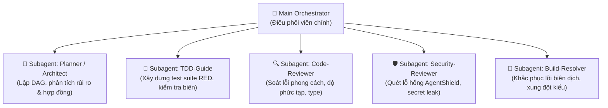

# Mô Hình Điều Phối Đặc Vụ Phụ Thuộc (ECC Subagent Orchestration Patterns)

Tài liệu này cung cấp phương pháp điều phối và phân quyền cho các **Đặc vụ Phụ (Subagents)** theo chuẩn ECC ([affaan-m/ecc](https://github.com/affaan-m/ecc)), giúp tối ưu hóa việc phân tách ngữ cảnh, tăng tốc độ xử lý song song và bảo đảm tính khách quan khi phản biện mã nguồn.

---

## 🎯 1. Tại Sao Phải Sử Dụng Subagents?

Khi một AI Agent đảm nhiệm tất cả các khâu (vừa lập kế hoạch, vừa code, vừa tự review):
- **Hiệu ứng thiên kiến xác nhận (Confirmation Bias)**: AI có xu hướng bỏ qua lỗi của chính đoạn code mình vừa viết ra.
- **Ô nhiễm ngữ cảnh (Context Saturation)**: Các file log dài, kết quả test chạy thử, và các phương án nháp làm cạn kiệt cửa sổ ngữ cảnh, dẫn đến việc agent bị "ảo giác" (*hallucination*).

**Giải pháp ECC**: Người điều phối chính (*Main Orchestrator*) ủy quyền các tác vụ độc lập cho các Subagent chuyên trách có ngữ cảnh trong sạch (*fresh context*).

---

## 🤖 2. Đặc Tả Chi Tiết Các Vai Trò Đặc Vụ (Specialized Agent Profiles)

### 1. `planner` & `architect`
- **Mục tiêu**: Nghiên cứu hiện trạng và sinh bản kế hoạch (`*.plan.md`).
- **Phạm vi quyền hạn**: Quyền đọc mã nguồn (`read-only`), không được phép sửa đổi file dự án.
- **Đầu ra**: Bảng phân rã nhiệm vụ (DAG) và danh sách Acceptance Criteria.

### 2. `tdd-guide`
- **Mục tiêu**: Xây dựng kịch bản kiểm thử toàn diện bảo vệ hệ thống trước khi code logic được viết.
- **Phạm vi quyền hạn**: Quyền tạo/sửa đổi file trong thư mục `tests/`.
- **Đầu ra**: Bằng chứng kiểm thử thất bại có chủ đích (RED Evidence).

### 3. `code-reviewer`
- **Mục tiêu**: Đánh giá khách quan diff mã nguồn từ một góc nhìn hoàn toàn mới.
- **Tiêu chí rà soát**:
  - Tuân thủ nguyên tắc Immutability và Clean Architecture.
  - Kiểm tra độ phức tạp của hàm ($< 50$ dòng, cyclomatic complexity thấp).
  - Không để lại `console.log`, `print` debug hoặc chú thích thừa.
- **Đầu ra**: Danh sách phát hiện phân cấp theo mức độ `[CRITICAL | HIGH | MEDIUM | LOW]`.

### 4. `security-reviewer`
- **Mục tiêu**: Thực thi kiểm tra độc lập theo tiêu chuẩn an ninh AgentShield.
- **Kích hoạt bắt buộc**: Bất cứ khi nào diff có chỉnh sửa liên quan đến Authentication, Authorization, Database queries, File path manipulation, hoặc External HTTP calls.

### 5. `build-error-resolver`
- **Mục tiêu**: Được triệu tập chuyên biệt khi quá trình build, typecheck (`tsc`, `pyright`, `mypy`) hoặc linter báo lỗi.
- **Đầu ra**: Đề xuất sửa đổi kiểu dữ liệu hoặc cấu hình tối thiểu để đưa trạng thái hệ thống về màu xanh.

---

## 🤝 3. Giao Thức Ủy Quyền & Tổng Hợp Kết Quả (Handoff Protocol)

Khi Main Orchestrator kích hoạt một Subagent:

1. **Truyền Ngữ Cảnh Tối Thiểu (Context Minimization)**:
   - Chỉ cung cấp đường dẫn các file liên quan trực tiếp, không dump toàn bộ codebase vào prompt của subagent.
   - Nêu rõ mục tiêu cần đạt được và tiêu chí hoàn thành.
2. **Thu Thập Bằng Chứng Đo Lường Được (Evidence-Based Synthesis)**:
   - Subagent phải trả về báo cáo có cấu trúc gồm: Trạng thái (`PASS/FAIL`), danh sách phát hiện, và các đoạn diff đề xuất.
3. **Quyết Định Của Orchestrator**:
   - Nếu `code-reviewer` hoặc `security-reviewer` phát hiện vấn đề ở mức `CRITICAL` hoặc `HIGH`: **Dừng lại ngay**, chuyển hướng sửa lỗi trước khi xin phê duyệt tại **GATE 2**.
