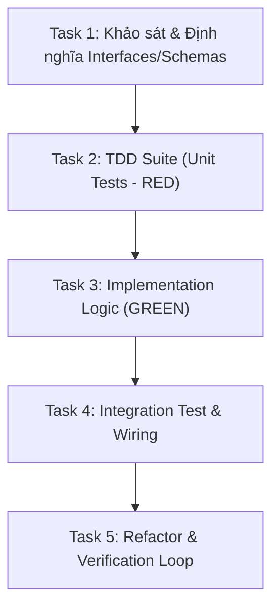

# [TÊN TÍNH NĂNG / TÁC VỤ]: BẢN KẾ HOẠCH THỰC THI (ECC IMPLEMENTATION PLAN)

> **Mã kế hoạch**: `PLAN-[YYYYMMDD]-[FEATURE_NAME]`  
> **Cấp độ quy mô (Right-Sizing Tier)**: `[Trivial | Small | Standard | Large]`  
> **Người thực hiện**: Antigravity Pair-Programming Agent  
> **Trạng thái**: Chờ duyệt (Pending Approval) / Đã duyệt (Approved)

---

## 1. Tóm Tắt Mục Tiêu & Phạm Vi (Scope & Boundaries)
- **Mục tiêu cốt lõi**: [Mô tả trong 1-2 câu ngắn gọn điều cần đạt được]
- **Phạm vi tác động (In-Scope)**:
  - File/Module 1: [Mục đích chỉnh sửa]
  - File/Module 2: [Mục đích chỉnh sửa]
- **Ngoài phạm vi (Out-of-Scope)**:
  - Những việc KHÔNG làm trong đợt này để tránh phình phạm vi (*Scope Creep*).

---

## 2. Tiêu Chuẩn Nghiệm Thu Đo Lường Được (Acceptance Criteria)
- [ ] **AC-1**: [Hành vi chuẩn xác trong kịch bản bình thường - Happy Path]
- [ ] **AC-2**: [Xử lý ngoại lệ an toàn khi dữ liệu biên hoặc dị thường - Edge Case]
- [ ] **AC-3**: [Đạt chuẩn độ phủ kiểm thử tối thiểu $\ge 80\%$]
- [ ] **AC-4**: [Không phát sinh lỗi Type check, Linting, hoặc Security Scan]

---

## 3. Phân Rã Đồ Thị Tác Vụ Có Hướng (Task DAG & Sequence)

### Danh Sách Tác Vụ Cụ Thể:
- [ ] **Task 1: Khảo sát & Hợp đồng Giao tiếp (Research & Contract)**
  - *File dự kiến*: `src/...`
  - *Mô tả*: Khai báo Type, Protocol, DTOs, hoặc Schemas rõ ràng.
- [ ] **Task 2: Viết Kiểm Thử Trước (TDD RED)**
  - *File dự kiến*: `tests/test_...`
  - *Mô tả*: Tạo các test case kiểm tra AC-1 và AC-2. Đảm bảo test chạy và thất bại đúng lý do.
- [ ] **Task 3: Hiện Thực Hóa Phẫu Thuật (Surgical Implementation GREEN)**
  - *File dự kiến*: `src/...`
  - *Mô tả*: Viết code tối thiểu để toàn bộ test case ở Task 2 chuyển sang màu xanh.
- [ ] **Task 4: Tích Hợp & Kết Nối Hệ Thống (Integration)**
  - *File dự kiến*: `src/...`
  - *Mô tả*: Kết nối module với hệ thống chính, xử lý I/O, database hoặc event bus.
- [ ] **Task 5: Xác Thực & Đánh Giá An Ninh (6-Phase Verification)**
  - *Mô tả*: Chạy đầy đủ Build, Type Check, Lint, Full Tests, và AgentShield Checklist.

---

## 4. Chốt Chặn An Ninh & Rủi Ro Tiềm Ẩn (AgentShield Security Analysis)
- **Dữ liệu nhạy cảm**: [Có sử dụng token, mật khẩu, PII không? Cơ chế bảo vệ là gì?]
- **Điểm nghẽn ranh giới (Boundaries)**: [Cơ chế validate dữ liệu đầu vào]
- **Rủi ro hồi quy (Regression Risk)**: [Những luồng tính năng nào có thể bị ảnh hưởng?]
- **Kế hoạch Rollback**: [Cách hoàn tác nếu phát sinh lỗi nghiêm trọng]

---

## 🚪 CỔNG PHÊ DUYỆT (GATE 1 CONFIRMATION)
*Người dùng vui lòng duyệt kế hoạch này trước khi agent tiến hành viết mã nguồn.*
- **Phê duyệt**: `Proceed` / `Đồng ý thực hiện`
- **Yêu cầu điều chỉnh**: Ghi chú các điểm cần sửa đổi.

