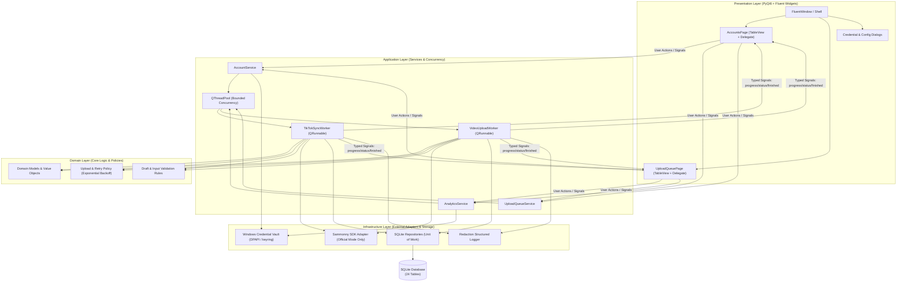
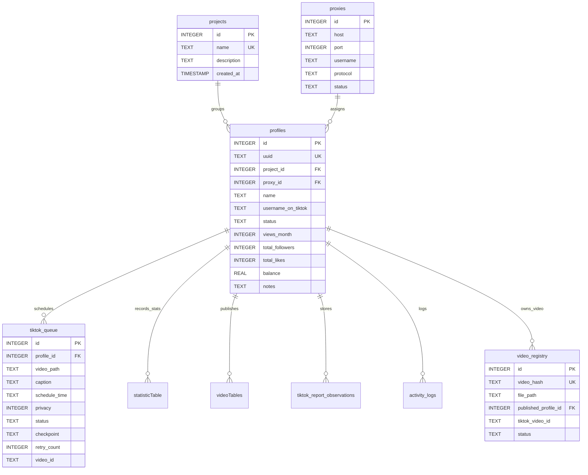
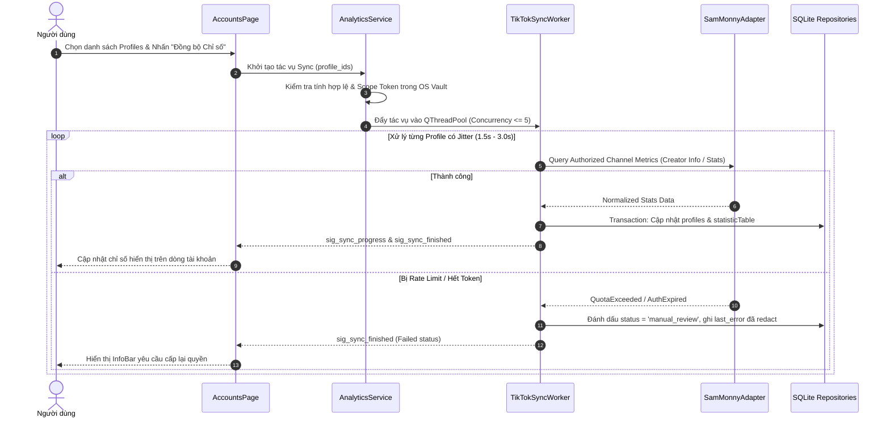
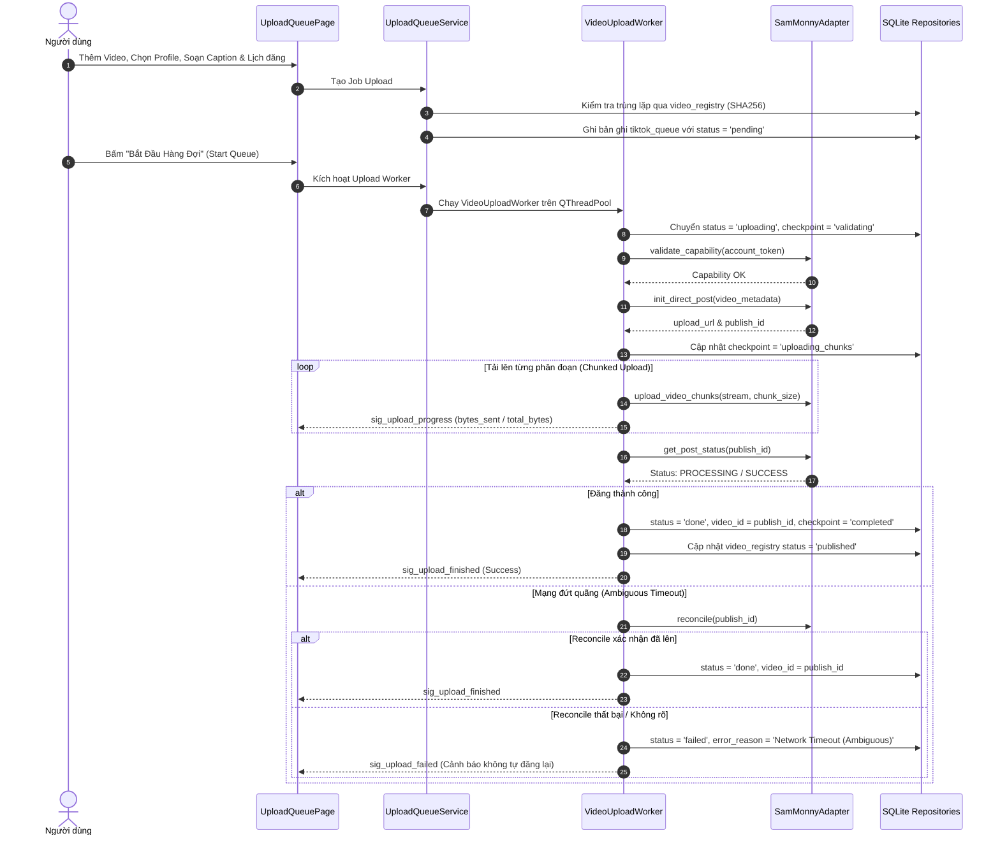
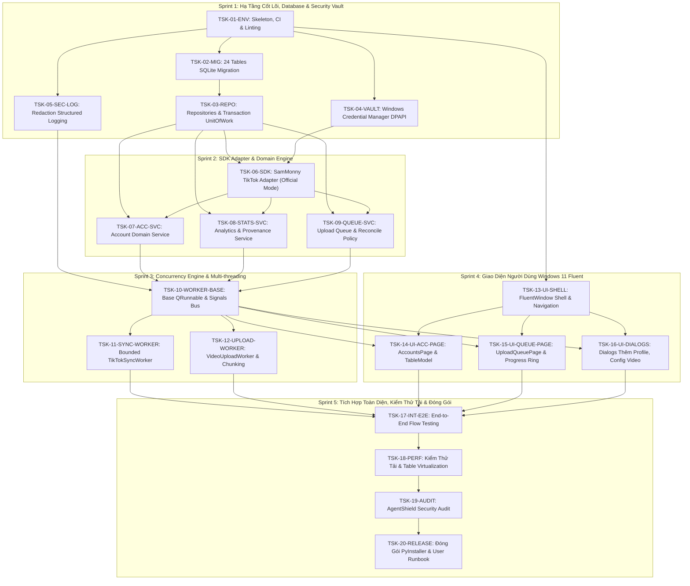
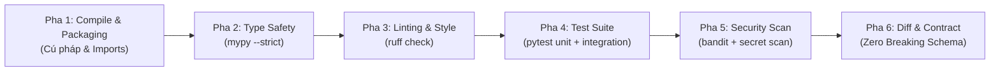

# TikTok Account & Video Manager
## Tài Liệu Đặc Tả Dự Án & Kế Hoạch Phân Rã Tác Vụ Chuẩn Công Nghiệp (Industrial Project Specification & Work Breakdown Structure)

- **Mã dự án:** `TAVM-2026-WIN`
- **Tiêu chuẩn quy trình:** ECC Development Lifecycle ([affaan-m/ecc](https://github.com/affaan-m/ecc) -> [.agents/skills/ecc-development-workflow/SKILL.md](file:///d:/TictokUpload411/.agents/skills/ecc-development-workflow/SKILL.md)) + Diátaxis Framework
- **Quy mô dự án (Right-Sizing Tier):** **Tier 4 — Large** (Đa tầng, tích hợp SDK ngoài, 24 bảng CSDL SQLite, Đa luồng Qt, Bảo mật OS Vault)
- **Chốt chặn kiểm duyệt:** Bắt buộc vượt qua **GATE 1** (Plan Approval) và **GATE 2** (Delivery Verification)
- **Ngôn ngữ mục tiêu:** Python 3.11+ (Strict Typing, PEP 484/526)
- **Giao diện mục tiêu:** PyQt6 + PyQt-Fluent-Widgets (Windows 11 Fluent Design System)
- **Cơ sở dữ liệu:** SQLite 3.38+ (Kế thừa nguyên trạng migration từ Gloglin2609, enforced PRAGMA foreign_keys = ON)
- **SDK Tích Hợp Đa Năng:** `sammonny` Python SDK 1.8.1 / 1.2.0 (`TikTokPublisherAdapter` Tri-Modal: Direct Post, Cookie Hybrid TOS, Headless Studio + In-Kernel Egress & KernelSignatureHarvester)
- **Kho lưu trữ bí mật (Secrets Vault):** Windows Credential Manager / DPAPI via `keyring` (AgentShield Tier-1 Protection)

---

> [!NOTE] **Nguyên Tắc Bằng Chứng & Phạm Vi Kỹ Thuật (Evidence & Scope Protocol)**
> 1. **Dữ liệu hiện trạng**: Được trích xuất trực tiếp từ các file migration nguồn (`init_schema.py`, `tiktok_schema.py`, `vault_credentials.py`) và DDL runtime trong các engine services. Do file SQLite ban đầu có kích thước 0 byte, toàn bộ schema được phục hồi dựa trên lịch sử migration danh định, không sao chép hoặc phụ thuộc vào dữ liệu có sẵn.
> 2. **Chính sách phân phối video**: Hệ thống tuân thủ 100% cơ chế ủy quyền chính thức (Official Authorized Direct Post & Draft APIs). Nghiêm cấm hoàn toàn việc lưu trữ token dạng plaintext, tự ý gọi API ngầm ngoài SDK, vượt rate-limit, hoặc giả lập session không có sự chấp thuận của người dùng.

---

## 1. Tổng Quan Hệ Thống & Quyết Định Kiến Trúc (Architecture & ADRs)

### 1.1 Tầm Nhìn & Mục Tiêu Kỹ Thuật

Xây dựng ứng dụng desktop chuẩn công nghiệp dành cho Windows 11, phục vụ công tác quản lý tài khoản TikTok số lượng lớn, theo dõi chỉ số tăng trưởng (Analytics) được ủy quyền và điều phối hàng đợi tải lên video (Upload Queue) tự động. 

Các tiêu chí chất lượng tối thượng (Quality Attributes):
1. **Crash-Proof & Non-blocking UI**: Tuyệt đối không thực thi I/O mạng hoặc truy vấn CSDL đồng bộ trên Main GUI Thread. Mọi tác vụ nặng chạy trên bounded worker pool (`QThreadPool`), giao tiếp đa luồng 100% bằng Typed Qt Signals/Slots.
2. **AgentShield Security Compliance**: Không bao giờ rò rỉ Access Token, Secret Key, Cookie hay thông tin định danh vào file log, thông báo lỗi UI hoặc commit mã nguồn. Secrets được lưu trữ trong Windows Credential Manager qua DPAPI.
3. **Database Provenance & Integrity**: Tuân thủ triệt để schema 24 bảng đã định nghĩa từ hệ thống migration gốc. Luôn bật ràng buộc khóa ngoại `PRAGMA foreign_keys = ON`, mọi giao dịch cập nhật hàng loạt đều đặt trong transaction boundary an toàn.
4. **Cooperative Cancellation & Idempotency**: Mọi worker đều phải hỗ trợ cờ hủy tác vụ hợp tác (`cancellation_token`). Cơ chế đăng video hỗ trợ kiểm tra trạng thái từ xa (Reconcile) và Exponential Backoff với Jitter, ngăn chặn đăng trùng video khi gặp timeout mạng.

---

### 1.2 Kiến Trúc Phân Tầng Clean Architecture

Ứng dụng được tổ chức theo mô hình Clean Architecture 4 tầng phân lập rõ ràng, tuân thủ nguyên tắc Dependency Inversion:



---

### 1.3 Bảng Quyết Định Kiến Trúc (Architecture Decision Records - ADRs)

| Mã ADR | Chủ đề quyết định | Lựa chọn áp dụng | Lý do & Đánh đổi kỹ thuật |
| :--- | :--- | :--- | :--- |
| **ADR-001** | UI Framework | **PyQt6 + PyQt-Fluent-Widgets** | Đảm bảo hiệu năng native tối ưu trên Windows 11, tiêu tốn ít RAM hơn hẳn Electron/Webview; tuân thủ hoàn hảo Fluent Design System 2.0. |
| **ADR-002** | Xử lý CSDL Kế thừa | **Bảo tồn nguyên trạng 24 bảng Migration** | Tuyệt đối không đổi tên cột hay tái cấu trúc bảng để đảm bảo tương thích 100% với các migration gốc và file database đồng hành (`gloglin.db`). |
| **ADR-003** | Lưu trữ Thông tin Nhạy cảm | **Windows Credential Manager (DPAPI)** | Tách hoàn toàn Access Token và API Secret ra khỏi SQLite database; ngăn ngừa triệt để nguy cơ trích xuất thông tin khi chia sẻ DB file. |
| **ADR-004** | Cơ chế Xử lý Đa nhiệm | **`QThreadPool` + `QRunnable` + Signal Dispatcher** | Ngăn GUI giật lag; hỗ trợ cooperative cancellation; dễ dàng kiểm soát concurrency tối đa theo hạn mức API TikTok. |
| **ADR-005** | Tích hợp TikTok SDK | **SamMonny Full Tri-Modal Pipeline** | Tái sử dụng 100% chức năng SDK: Tri-Modal Publisher (Direct Post, Cookie Hybrid TOS 5MB + V8 Fetch, Headless Studio), Bộ ký mật mã ByteDance siêu tốc (>21,000 sig/s), In-Kernel Egress chống lộ JA3/JA4, và giải phóng 99% RAM qua MemoryManager. |

---

### 1.4 Cấu Trúc Thư Mục Mã Nguồn Chuẩn Doanh Nghiệp

```text
TictokUpload411/
├── app/                                 # Điểm khởi chạy & Khởi tạo ứng dụng
│   ├── __init__.py
│   ├── main.py                          # Entry point chính thức
│   ├── bootstrap.py                     # Khởi tạo DB, Logging, Vault & Theme
│   └── config.py                        # Cấu hình tĩnh, Constants & AppSettings
├── presentation/                        # Tầng hiển thị (Presentation Layer)
│   ├── windows/
│   │   ├── __init__.py
│   │   └── main_window.py               # FluentWindow, NavigationInterface, StatusBar
│   ├── pages/
│   │   ├── __init__.py
│   │   ├── accounts_page.py             # Bảng quản lý tài khoản, bộ lọc, commands
│   │   ├── upload_queue_page.py         # Bảng hàng đợi upload, progress, action bar
│   │   └── settings_page.py             # Cấu hình quota, proxy, theme & storage
│   ├── dialogs/
│   │   ├── add_profile_dialog.py        # Thêm / Import tài khoản thủ công
│   │   ├── batch_import_dialog.py       # Import danh sách profile kèm validation
│   │   └── video_config_dialog.py       # Thiết lập caption, tags, privacy, lịch đăng
│   ├── models/
│   │   ├── account_table_model.py       # QAbstractTableModel cho Profiles
│   │   └── queue_table_model.py         # QAbstractTableModel cho Upload Queue
│   └── delegates/
│       ├── badge_delegate.py            # Custom Delegate hiển thị InfoBadge / Tags
│       └── progress_delegate.py         # Custom Delegate vẽ ProgressBar nội tuyến
├── application/                         # Tầng ứng dụng (Application Services & Workers)
│   ├── services/
│   │   ├── account_service.py           # Quản lý vòng đời Profile, Import & Soft-delete
│   │   ├── analytics_service.py         # Điều phối thu thập chỉ số được ủy quyền
│   │   └── upload_service.py            # Điều phối hàng đợi, checkpoint & retry
│   ├── workers/
│   │   ├── base_worker.py               # Base QRunnable với cooperative cancellation
│   │   ├── tiktok_sync_worker.py        # Worker quét chỉ số & trạng thái tài khoản
│   │   └── video_upload_worker.py       # Worker tải lên video phân đoạn & reconcile
│   └── signals/
│       ├── app_signals.py               # Toàn bộ Signal Bus xuyên tầng ứng dụng
│       └── payload_types.py             # Dataclass định kiểu chặt chẽ cho signal payloads
├── domain/                              # Tầng nghiệp vụ cốt lõi (Domain Models & Rules)
│   ├── models/
│   │   ├── profile.py                   # Thực thể Profile
│   │   ├── video_job.py                 # Thực thể Hàng đợi Video
│   │   └── metric_snapshot.py           # Bản ghi đo lường chỉ số
│   ├── policies/
│   │   ├── upload_policy.py             # Quy tắc retry, exponential backoff, rate-limits
│   │   └── validation_policy.py         # Kiểm tra dung lượng video, định dạng, caption
│   └── exceptions/
│       └── base_exceptions.py           # Phả hệ ngoại lệ chuẩn (AppError, AuthError, QuotaError)
├── infrastructure/                      # Tầng hạ tầng & Tích hợp ngoài (Infrastructure)
│   ├── database/
│   │   ├── connection.py                # Quản lý SQLite Connection, PRAGMAs, Transactions
│   │   ├── migrations/                  # Port 100% migration script chuẩn từ Gloglin
│   │   │   ├── init_schema.py
│   │   │   ├── tiktok_schema.py
│   │   │   ├── vault_credentials.py
│   │   │   └── runtime_ddl.py
│   │   └── repositories/
│   │       ├── base_repository.py       # CRUD trừu tượng
│   │       ├── profile_repository.py    # Xử lý truy vấn profiles, joins proxy
│   │       ├── queue_repository.py      # Xử lý tiktok_queue, checkpoint
│   │       └── stats_repository.py      # Xử lý statisticTable, videoTables
│   ├── credentials/
│   │   └── windows_vault.py             # Adapter Windows Credential Manager / DPAPI
│   ├── logging/
│   │   └── redaction_logger.py          # Logger cấu trúc tự động che mờ secrets
│   └── tiktok/
│       └── sammonny_adapter.py          # Wrapper an toàn bọc SamMonny SDK 1.8.1
├── resources/                           # Tài nguyên đồ họa, icons, theme qss
│   ├── icons/
│   └── styles/
├── tests/                               # Kiểm thử tự động (TDD Suite)
│   ├── unit/
│   │   ├── test_repositories.py
│   │   ├── test_domain_policies.py
│   │   └── test_sammonny_adapter.py
│   ├── integration/
│   │   ├── test_migration_pipeline.py
│   │   └── test_worker_signals.py
│   └── ui/
│       └── test_table_models.py
├── pyproject.toml                       # Định nghĩa dự án & Dependencies (PEP 621)
├── requirements.txt                     # Dependencies cố định phiên bản
└── PROJECT_SPEC.md                      # Tài liệu này
```

---

## 2. Đặc Tả Giao Diện Người Dùng (UI/UX Specification)

### 2.1 Bố Cục Bảng Kép (Dual-Table Dashboard)

Dựa trên thiết kế tham chiếu, giao diện chính tuân thủ bố cục làm việc hiệu năng cao với cấu trúc bảng kép:

```text
+======================================================================================================================+
| [FluentIcon] TikTok Studio Manager v2.0 - [Dự án mặc định]                     [Q Tìm kiếm nhanh (Ctrl+F)] [_] [O] [X]|
+----------------------------------------------------------------------------------------------------------------------+
| [Menu: File v] [Dự Án v] [Công Cụ v] [Dọn Trình Duyệt] [Thùng Rác] [Cài Đặt]                  [Theme: [Light / Dark] ]|
+----------------------------------------------------------------------------------------------------------------------+
| [ Dự Án: [Dự án mặc định  v] ] [IconCam] [IconVideo] [IconGear] | [Luồng: [ 10 ]-+] [ Q Tìm ID, email, proxy... ]   |
| [ + Thêm 1 Profile ] [ ++ Thêm Nhiều ] [ Hiện Tất Cả ] [ Mở Browser (GoLogin/Chrome) ]                                |
+----------------------------------------------------------------------------------------------------------------------+
| BẢNG 1: QUẢN LÝ HỒ SƠ TÀI KHOẢN (Profiles Table - Fluent Style)       [Preset: (x) Tất cả  ( ) Doanh Thu  ( ) Kỹ Thuật]|
|----------------------------------------------------------------------------------------------------------------------|
| [v] | Avt  | Tên Hồ Sơ  | Logged | Proxy          | ID TikTok     | Views(30d) | Flw  | LIVE  | $Earned | KYC | Ghi Chú |
|----------------------------------------------------------------------------------------------------------------------|
| [x] | (•)  | US_Beta_01 | [Yes]  | http:192.168.1 | @stirkjaulerc | 24,360     | 13   | [LIVE]| $145.20 | [No]| Main US |
| [ ] | (•)  | US_Beta_02 | [Yes]  | http:10.0.0.12 | @otwaylsari   | 43,586     | 94   | [LIVE]| $320.00 | [No]| Beta UK |
+======================================================================================================================+
| ======= [===] Thanh trượt QSplitter (Kéo mở rộng hoặc Click nút [v] để thu gọn/mở nhanh) [===] =======================|
+======================================================================================================================+
| BẢNG 2: DANH SÁCH & HÀNG ĐỢI VIDEO  |  [ Đã chọn 1 / 7,122 video ]                   [ Q Tìm video theo tiêu đề... ]  |
| [ Icon Folder ] [ Icon Render ] [ Lên Lịch Đăng ] [ Nhảy dòng: [ 0 ] ]               [ Xóa Bảng ] [ Tự Động: (ON) ]  |
|----------------------------------------------------------------------------------------------------------------------|
| STT | Tiêu Đề Video       | View | Like | Thời Lượng | Chế Độ   | Lên Lịch Đăng    | Kênh Gán   | Tiến Độ (Source)       |
|----------------------------------------------------------------------------------------------------------------------|
| 1   | Cooking Master Ep 1 | 12k  | 1.4k | 00:00:45   | [Public] | 2026-11-04 19:00 | US_Beta_01 | [======== 100% ======] |
| 2   | Gadget Review 2026  | 85k  | 9.2k | 00:01:10   | [Public] | 2026-11-04 20:30 | US_Beta_02 | [==== 55%           ] |
+----------------------------------------------------------------------------------------------------------------------+
| [Status Card] Xin chào: peps | Bản quyền: Gôepro (Hạn: 07-08-2026) | v1.5.5.2         [v] Dọn cache dự án khi thoát  |
+======================================================================================================================+
```

---

### 2.2 Quy Chuẩn Bảng Quản Lý Hồ Sơ (Accounts Table - Đầy đủ 28 Cột MMO Chuẩn Ảnh)

Hệ thống kế thừa trọn vẹn 28 cột dữ liệu từ giao diện thực tế nhưng được hiện đại hóa với Fluent Widgets & Delegates:

| STT | Tên Cột | Trường CSDL | Kiểu Hiển Thị / Delegate | Chế Độ Preset Mặc Định |
| :---: | :--- | :--- | :--- | :--- |
| 1 | **Avt** | `avatar_url` / `avatar_path` | `RoundPixmapDelegate` (28x28px bo tròn mịn) | Bật (All / Tổng quan) |
| 2 | **Tên hồ sơ** | `name` | `BodyStrongLabel` (Segoe UI 13px) | Bật (All / Tổng quan) |
| 3 | **Logged** | `state_loggin_browser` | `PillBadge` (Yes: Xanh dịu, No: Xám) | Bật (All / Kỹ thuật) |
| 4 | **Proxy** | `proxies.host:port` | `CaptionLabel` rút gọn (Ẩn user/pass) | Bật (All / Kỹ thuật) |
| 5 | **Type** | `proxies.type` | Text tag (`http`, `socks5`) | Bật (All / Kỹ thuật) |
| 6 | **ID Tiktok** | `username_on_tiktok` | `HyperlinkButton` style (Click để sao chép) | Bật (All / Tổng quan) |
| 7 | **Views(30d)** | `views_month` | Numeric formatted (`24,360`) | Bật (All / Doanh thu) |
| 8 | **T.Follows** | `total_followers` | Numeric formatted (`13`) | Bật (All / Doanh thu) |
| 9 | **T.Views** | `total_views` | Numeric formatted (`24,360`) | Bật (All / Doanh thu) |
| 10 | **T.Video** | `total_videos` | Numeric formatted (`118`) | Bật (All / Doanh thu) |
| 11 | **Email** | `email` | Masked text (`a***@gmail.com`) | Bật (All / Kỹ thuật) |
| 12 | **Tình trạng** | `status` | `InfoBadge` (LIVE: Xanh ngọc, DIE: Đỏ, CHECKPOINT: Cam) | Bật (All / Tổng quan) |
| 13 | **Cookie** | `tokens.cookie` | Masked dots (`••••••••`) an toàn AgentShield | Bật (All / Kỹ thuật) |
| 14 | **$Earned** | `earned_amount` | Currency formatted (`$145.20`, màu xanh lục) | Bật (All / Doanh thu) |
| 15 | **$Balance** | `balance` | Currency formatted (`$50.00`) | Bật (All / Doanh thu) |
| 16 | **CS** | `creativity_status`| Status Tag (`Beta`, `Rewards`) | Bật (All / Doanh thu) |
| 17 | **RPM** | `rpm` | Number (`$0.85`) | Bật (All / Doanh thu) |
| 18 | **QG** | `country_code` | Quốc kỳ / Mã quốc gia (`US`, `UK`, `FR`) | Bật (All / Doanh thu) |
| 19 | **KYC** | `kyc_status` | Badge (`Yes`, `No`) | Bật (All / Doanh thu) |
| 20 | **Note** | `notes` | Editable Text Cell (Bấm Enter lưu vào DB) | Bật (All / Tổng quan) |
| 21 | **Re.Apply** | `reapply_date` | Date Label (`2026-11-20`) | Bật (All / Doanh thu) |
| 22 | **PRIVACY** | `default_privacy` | Tag (`PUBLIC`, `PRIVATE`) | Bật (All / Kỹ thuật) |
| 23 | **VAT** | `tax_status` | Tag (`Yes`, `No`) | Bật (All / Doanh thu) |
| 24 | **TS** | `verified_badge` | Icon huy hiệu (Tích xanh/sao) | Bật (All / Doanh thu) |
| 25 | **STT** | Row index | Số thứ tự tự động | Bật (All) |
| 26 | **VVP** | `copyright_strikes`| Badge cảnh báo vi phạm bản quyền | Bật (All / Kỹ thuật) |
| 27 | **MP** | `secondary_pin` | Masked (`•••`) mã PIN phụ | Bật (All / Kỹ thuật) |
| 28 | **ID** | `id` | Primary Key CSDL | Bật (All / Kỹ thuật) |

---

### 2.3 Quy Chuẩn Bảng Danh Sách & Hàng Đợi Video (Upload Table)

Bảng dưới kế thừa toàn bộ thanh công cụ phân phối video và các cột từ ảnh thực tế:

| Tên Cột | Trường Dữ Liệu Tương Ứng | Kiểu Hiển Thị / Delegate | Thao Tác Trực Tiếp |
| :--- | :--- | :--- | :--- |
| **STT** | Row index | Center Label | Đánh số thứ tự video |
| **Tiêu đề** | `title` / `caption` | `BodyLabel` Semibold | Nhấp đúp để chỉnh sửa |
| **Lượt view** | `views` | Numeric formatted | Thống kê lượt xem |
| **Lượt like** | `likes` | Numeric formatted | Thống kê lượt thích |
| **Duration** | `duration` | Monospace Label (`00:00:45`) | Thời lượng video |
| **Hiển thị** | `visibility` | `ComboBox` / `PillBadge` | Đổi Public / Friends / Private |
| **Lên lịch** | `schedule_time` | DateTime Label | Cấu hình lịch đăng tự động |
| **Upload To** | `assigned_profile` | Fluent Badge | Gán kênh TikTok đăng bài |
| **Tình trạng** | `status` | Status Badge | `Downloaded`, `Ready`, `Uploading`, `Done` |
| **Source** | `progress` | `ProgressBar` Fluent bo góc 4px | Thanh tiến độ mượt mà từ 0% đến 100% |
| **Link gốc** | `source_url` | Hyperlink label | Đường dẫn video nguồn (Reup) |
| **ID Video** | `video_id` | Text copyable | Mã video TikTok trả về |
| **PVF URL** | `preview_video_url` | Linkable label | Đường dẫn file video xem trước |
| **PAF URL** | `preview_audio_url` | Linkable label | Đường dẫn file âm thanh xử lý |

---

### 2.4 Hợp Đồng Luồng Tín Hiệu Đa Luồng (Typed Qt Signals/Slots Contract)

Mọi giao tiếp giữa Application Workers và GUI Presentation bắt buộc phải truyền qua các tín hiệu định kiểu sau:

```python
from dataclasses import dataclass
from typing import Optional, Dict, Any
from PyQt6.QtCore import QObject, pyqtSignal

@dataclass(frozen=True)
class SyncProgressPayload:
    profile_id: int
    task_name: str
    percent: int
    message: str

@dataclass(frozen=True)
class SyncResultPayload:
    profile_id: int
    success: bool
    status_text: str
    metrics: Dict[str, Any]
    error_message: Optional[str] = None

@dataclass(frozen=True)
class UploadProgressPayload:
    job_id: int
    profile_id: int
    bytes_sent: int
    total_bytes: int
    percent: int

@dataclass(frozen=True)
class UploadCompletedPayload:
    job_id: int
    publish_id: str
    video_id: Optional[str]
    remote_status: str

@dataclass(frozen=True)
class UploadErrorPayload:
    job_id: int
    error_code: str
    redacted_reason: str
    is_retryable: bool

class AppSignalBus(QObject):
    # Signals đồng bộ trạng thái & chỉ số
    sig_sync_started = pyqtSignal(int)                         # total_jobs
    sig_sync_progress = pyqtSignal(SyncProgressPayload)        # payload
    sig_sync_finished = pyqtSignal(SyncResultPayload)          # payload
    sig_sync_all_done = pyqtSignal(dict)                       # summary stats

    # Signals hàng đợi upload video
    sig_upload_started = pyqtSignal(int)                       # job_id
    sig_upload_progress = pyqtSignal(UploadProgressPayload)    # payload
    sig_upload_status = pyqtSignal(int, str, str)              # job_id, status, checkpoint
    sig_upload_finished = pyqtSignal(UploadCompletedPayload)   # payload
    sig_upload_failed = pyqtSignal(UploadErrorPayload)         # payload
    sig_upload_cancelled = pyqtSignal(int)                     # job_id
```

---

## 3. Thiết Kế Cơ Sở Dữ Liệu & Bảo Mật Dữ Liệu (Database & Security)

### 3.1 Toàn Bộ 24 Bảng SQLite Kế Thừa (Migration Schema Specification)

Để đảm bảo tính liên tục của dữ liệu và khả năng tương thích tuyệt đối, 24 bảng dữ liệu được bảo lưu cấu trúc và kiểu dữ liệu chính xác:

| STT | Tên Bảng | Vai Trò & Mô Tả | Khóa Chính (PK) | Ràng Buộc Khóa Ngoại (FK) & Unique |
| :--- | :--- | :--- | :--- | :--- |
| 1 | `projects` | Quản lý dự án / nhóm phân loại profile | `id` INTEGER | `name` UNIQUE |
| 2 | `proxies` | Quản lý proxy mạng (HTTP/SOCKS5/Mobile) | `id` INTEGER | UNIQUE `(host, port, username)` |
| 3 | `profiles` | Bảng lõi quản lý thông tin profile & TikTok | `id` INTEGER | UNIQUE `uuid`; FK `project_id -> projects.id`; FK `proxy_id -> proxies.id` |
| 4 | `profile_fonts` | Danh sách font của profile browser | `id` INTEGER | FK `profile_id -> profiles.id ON DELETE CASCADE` |
| 5 | `activity_logs` | Nhật ký hành động trên tài khoản | `id` INTEGER | FK `profile_id -> profiles.id ON DELETE CASCADE` |
| 6 | `proxy_credential_issues`| Ghi nhận lỗi xác thực proxy | `proxy_id` INTEGER | FK `proxy_id -> proxies.id ON DELETE CASCADE` |
| 7 | `tiktok_sessions` | Quản lý phiên làm việc đã lưu | `profile_id` INTEGER | FK `profile_id -> profiles.id ON DELETE CASCADE` |
| 8 | `tiktok_queue` | Hàng đợi tải lên và lên lịch đăng video | `id` INTEGER | FK `profile_id -> profiles.id ON DELETE CASCADE`; CHECK status |
| 9 | `affiliate_products` | Sản phẩm tiếp thị liên kết gắn video | `id` INTEGER | FK `profile_id -> profiles.id ON DELETE CASCADE` |
| 10 | `statisticTable` | Bảng số liệu chi tiết theo từng video | `id` INTEGER | FK `profile_id -> profiles.id ON DELETE CASCADE`; UNIQUE `(profile_id, id_video)` |
| 11 | `phoneParams` | Cấu hình tham số thiết bị di động | `id` INTEGER | FK `profile_id -> profiles.id ON DELETE CASCADE`; UNIQUE `profile_id` |
| 12 | `violateVideos` | Danh mục video vi phạm chính sách | `id` INTEGER | FK `profile_id -> profiles.id ON DELETE CASCADE` |
| 13 | `violateProfiles` | Danh mục hồ sơ bị cảnh báo/vi phạm | `id` INTEGER | FK `profile_id -> profiles.id ON DELETE CASCADE` |
| 14 | `videoTables` | Bảng tổng hợp siêu dữ liệu video đã đăng | `id` INTEGER | FK `profile_id -> profiles.id ON DELETE CASCADE`; UNIQUE `(profile_id, video_id)` |
| 15 | `accountAppeals` | Quản lý đơn kháng cáo tài khoản/video | `id` INTEGER | FK `profile_id -> profiles.id ON DELETE CASCADE` |
| 16 | `tiktok_report_observations`| Quan sát báo cáo phân tích theo loại | `(profile_id, report_kind)` | FK `profile_id -> profiles.id ON DELETE CASCADE` |
| 17 | `video_registry` | Đăng ký nhận diện hash video chống trùng | `id` INTEGER | UNIQUE `video_hash`; FK `assigned_profile_id`, `published_profile_id` |
| 18 | `tiktok_http_policy` | Chính sách kiểm soát tần suất kết nối | `profile_id` INTEGER | FK `profile_id -> profiles.id ON DELETE CASCADE` |
| 19 | `system_metadata` | Siêu dữ liệu phiên bản & bản quyền hệ thống | `key` TEXT | Khóa chính dạng chuỗi |
| 20 | `video_signature` | Dấu vân tay video (C2PA & frame hash) | `(user_id, path_key)` | Khóa chính ghép |
| 21 | `duplicate_check_config` | Cấu hình kiểm tra video trùng lặp | `id` TEXT | Phục vụ engine duplicate check |
| 22 | `duplicate_check_lease` | Quản lý lock/lease kiểm tra trùng lặp | `config_id` TEXT | Khóa logic phân tán |
| 23 | `duplicate_check_log` | Lịch sử đối soát và kết quả kiểm tra | `id` TEXT | Ghi nhận chi tiết trùng lặp |
| 24 | `channel_quality_reports` | Báo cáo đánh giá chất lượng kênh (AI/Radar)| `id` TEXT | Lưu trữ metrics và phân tích heuristic |

---

### 3.2 Sơ Đồ Quan Hệ Thực Thể Trọng Tâm (Core Entity-Relationship Diagram)



---

### 3.3 Chuẩn An Ninh Dữ Liệu AgentShield (Secret Vault & Redaction)

1. **Cô lập bí mật hoàn toàn (Zero Secret Storage in Plaintext)**:
   - Các trường `auth_2fa`, `totp_secret`, `password`, `cookies_json` không bao giờ được lưu trữ dưới dạng bản rõ trong SQLite.
   - Khi sử dụng xác thực OAuth chính thức với TikTok qua SamMonny SDK, toàn bộ `access_token`, `refresh_token` và `client_secret` được lưu trong **Windows Credential Manager** sử dụng DPAPI thông qua package `keyring` với namespace `TikTokUploadManager.Profile.<profile_id>`.
2. **Bộ lọc làm sạch nhật ký (Redaction Logging Filter)**:
   - Một `RedactionFilter` tự động tích hợp vào hệ thống logging chuẩn (`logging.Filter`).
   - Mọi từ khóa khớp regex token, bearer token, cookie, password đều bị thay thế bằng chuỗi `***REDACTED***` trước khi ghi ra file hoặc đẩy lên giao diện người dùng.

---

## 4. Quy Trình Nghiệp Vụ Chuyên Sâu (Deep Domain Workflows)

### 4.1 Quy Trình Thu Thập Chỉ Số Được Ủy Quyền (Authorized Analytics Sync)



---

### 4.2 Quy Trình Đăng Video Chính Thức (Official Video Direct Post)



---

## 5. Phân Rã Tác Vụ Chuẩn Công Nghiệp (Industrial WBS & Task Breakdown)

### 5.1 Phân Loại Quy Mô & Đồ Thị Phụ Thuộc (DAG)

Dự án thuộc **Tier 4 (Large)**. Mọi thay đổi đều phải tuân thủ chu trình:  
$\text{TDD (Red)} \rightarrow \text{Implementation (Green)} \rightarrow \text{Refactor} \rightarrow \text{Verification (6-Phase)} \rightarrow \text{Gate 2 Commit}$.



---

### 5.2 Danh Mục Chi Tiết 20 Tác Vụ Kỹ Thuật (Work Packages)

#### 📦 EPIC 1: Hạ Tầng Cốt Lõi, Database & Security Vault (Sprint 1)

##### `TSK-01-ENV`: Thiết lập Project Skeleton, Virtual Environment & Quality Gates
- **Mục tiêu**: Xây dựng khung thư mục chuẩn Clean Architecture, cấu hình ảo hóa môi trường, pre-commit hooks, cấu hình type check và linting.
- **Tiền đề (Dependencies)**: Không.
- **Đầu vào (Inputs)**: Đặc tả cấu trúc thư mục mục 1.4.
- **Đầu ra (Deliverables)**:
  - Cấu trúc thư mục hoàn chỉnh với các file `__init__.py`.
  - `pyproject.toml` cấu hình `ruff`, `mypy --strict`, `pytest`.
  - `requirements.txt` ghim chính xác phiên bản các thư viện chính (`PyQt6==6.7.1`, `PyQt-Fluent-Widgets==1.6.4`, `keyring==24.3.1`, `pytest==8.2.0`).
- **Tiêu chí nghiệm thu (DoD / Acceptance Criteria)**:
  - [x] Lệnh `python -m venv .venv` và kích hoạt thành công.
  - [x] Lệnh `ruff check .` và `mypy .` chạy không có lỗi cấu hình.
  - [x] Script mẫu `tests/unit/test_sanity.py` chạy qua với `pytest`.

##### `TSK-02-MIG`: Triển khai 24 Bảng SQLite Migration & Database Connection Manager
- **Mục tiêu**: Port toàn bộ DDL migration từ `Gloglin2609` vào hệ thống mới, đảm bảo thiết lập kết nối an toàn với PRAGMA foreign keys.
- **Tiền đề**: `TSK-01-ENV`.
- **Đầu vào**: Các migration script trong source gốc (`init_schema.py`, `tiktok_schema.py`, `vault_credentials.py`, runtime DDL).
- **Đầu ra**:
  - `infrastructure/database/connection.py`: Quản lý pool kết nối SQLite thread-safe, tự động thực thi `PRAGMA foreign_keys = ON; PRAGMA journal_mode = WAL;`.
  - `infrastructure/database/migrations/`: Toàn bộ các script tạo đúng 24 bảng.
- **Tiêu chí nghiệm thu (DoD)**:
  - [x] Khởi tạo database mới từ đầu (`test_app.db`), thực thi migration tạo đầy đủ 24 bảng không lỗi cú pháp.
  - [x] `PRAGMA table_info` và `PRAGMA foreign_key_list` trên 24 bảng khớp 100% với đặc tả mục 3.1.
  - [x] Kiểm tra chèn vi phạm ràng buộc khóa ngoại (Foreign Key Violation) bị SQLite từ chối ngay lập tức.

##### `TSK-03-REPO`: Xây dựng Base Repository & Repositories Chuyên Biệt
- **Mục tiêu**: Tạo các lớp truy xuất dữ liệu an toàn theo mô hình Unit of Work, bao đóng toàn bộ truy vấn SQL.
- **Tiền đề**: `TSK-02-MIG`.
- **Đầu vào**: Schema 24 bảng và domain models sơ bộ.
- **Đầu ra**:
  - `BaseRepository` cung cấp context manager quản lý transaction (`BEGIN`, `COMMIT`, `ROLLBACK`).
  - `ProfileRepository`: Truy vấn danh sách profiles, lọc theo project/proxy/status, join lấy thông tin proxy, soft-delete.
  - `QueueRepository`: Quản lý hàng đợi `tiktok_queue`, cập nhật atomic checkpoint/status, kiểm tra trùng lặp `video_registry`.
  - `StatsRepository`: Ghi nhận dữ liệu snapshot vào `statisticTable`, `videoTables`, `tiktok_report_observations`.
- **Tiêu chí nghiệm thu (DoD)**:
  - [x] Viết unit test TDD kiểm thử rollback: khi một thao tác ghi trong transaction bị lỗi, toàn bộ dữ liệu trước đó không bị biến đổi.
  - [x] 100% truy vấn dùng parameterized query (`?`), không cộng chuỗi SQL.

##### `TSK-04-VAULT`: Triển khai Windows Credential Manager DPAPI Vault
- **Mục tiêu**: Hiện thực hóa tầng lưu trữ thông tin nhạy cảm (Access Token, Client Secrets) dựa trên Windows DPAPI.
- **Tiền đề**: `TSK-01-ENV`.
- **Đầu vào**: Thư viện `keyring` và Windows Credential Manager API.
- **Đầu ra**: `infrastructure/credentials/windows_vault.py` với interface `CredentialVault`:
  - `store_token(profile_id: int, token_data: dict) -> None`
  - `retrieve_token(profile_id: int) -> Optional[dict]`
  - `delete_token(profile_id: int) -> bool`
- **Tiêu chí nghiệm thu (DoD)**:
  - [x] Token lưu trữ được mã hóa bởi DPAPI của người dùng Windows hiện tại.
  - [x] Truy cập Windows Credential Manager trong Control Panel thấy định danh được lưu đúng namespace.
  - [x] Test tự động ghi và đọc lại token chính xác, xử lý ngoại lệ khi không tìm thấy.

##### `TSK-05-SEC-LOG`: Thiết Lập Redaction Structured Logging System
- **Mục tiêu**: Tạo cơ chế ghi log chuẩn JSON/Text tự động lọc và giấu toàn bộ chuỗi nhạy cảm.
- **Tiền đề**: `TSK-01-ENV`.
- **Đầu vào**: Regex định danh các chuỗi nhạy cảm (JWT, Bearer, Cookie, Password).
- **Đầu ra**: `infrastructure/logging/redaction_logger.py`.
- **Tiêu chí nghiệm thu (DoD)**:
  - [x] Đưa vào chuỗi log chứa `Bearer ya29.a0AfH6...` hoặc `password="MySecret123"`, file log xuất ra chuỗi `***REDACTED***`.
  - [x] Định dạng log gồm: `timestamp`, `level`, `thread_id`, `module`, `message`, `correlation_id`.

---

#### 📦 EPIC 2: SDK Adapter & Domain Engine Core (Sprint 2)

##### `TSK-06-SDK-ADAPT`: Triển khai SamMonny TikTok Adapter (Official Mode Only)
- **Mục tiêu**: Bọc SDK `sammonny` 1.8.1 thành một adapter thống nhất, chỉ kích hoạt chế độ Official Direct Post.
- **Tiền đề**: `TSK-03-REPO`, `TSK-04-VAULT`.
- **Đầu vào**: `D:\SamMonnygocLiengXiPoker\SamMonnygocLiengXiPoker\sdk\python\sammonny\platforms\tiktok.py`.
- **Đầu ra**:
  - `infrastructure/tiktok/sammonny_adapter.py`: Lớp `TikTokOfficialAdapter`.
  - `FakeTikTokAdapter`: Phục vụ môi trường kiểm thử không cần gọi mạng thật.
- **Tiêu chí nghiệm thu (DoD)**:
  - [x] Adapter chỉ gọi `TikTokDirectPostClient` và `TikTokPublisherAdapter`.
  - [x] Không tồn tại bất kỳ import hay tham chiếu nào tới chế độ cookie/headless.
  - [x] Khi token hết hạn hoặc thiếu scope, ném ra ngoại lệ chuẩn `AuthorizationRequiredException`.

##### `TSK-07-ACC-SVC`: Triển khai Account Management Domain Service
- **Mục tiêu**: Xử lý logic nghiệp vụ quản lý hồ sơ: thêm mới, import hàng loạt, gắn proxy, cập nhật trạng thái.
- **Tiền đề**: `TSK-03-REPO`, `TSK-04-VAULT`.
- **Đầu vào**: Đặc tả nghiệp vụ tài khoản mục 4.1.
- **Đầu ra**: `application/services/account_service.py` (`AccountService`).
- **Tiêu chí nghiệm thu (DoD)**:
  - [x] Hàm `batch_import_profiles(records: list[dict])` kiểm tra tính hợp lệ dữ liệu, phát hiện trùng lặp `uuid`.
  - [x] Hỗ trợ soft-delete (đánh dấu `is_trashed = 1`) thay vì xóa cứng.

##### `TSK-08-ANALYTICS-SVC`: Triển khai Analytics Domain Service
- **Mục tiêu**: Quản lý việc đọc, chuẩn hóa và lưu trữ chỉ số kênh (Views, Followers, Likes, Engagement).
- **Tiền đề**: `TSK-03-REPO`, `TSK-06-SDK-ADAPT`.
- **Đầu vào**: Dữ liệu trả về từ official SDK creator info.
- **Đầu ra**: `application/services/analytics_service.py` (`AnalyticsService`).
- **Tiêu chí nghiệm thu (DoD)**:
  - [x] Phân biệt rõ ràng giữa chỉ số trọn đời (Lifetime) và chỉ số 30 ngày (`views_month`).
  - [x] Dữ liệu thu thập luôn gắn nhãn nguồn gốc (`provenance`) gồm `source = 'official_sdk'` và `observed_at`.

##### `TSK-09-UPLOAD-SVC`: Triển khai Upload Queue Service & Reconcile Engine
- **Mục tiêu**: Quản lý vòng đời hàng đợi video: kiểm tra định dạng media, chống trùng hash SHA256, lên lịch và đối soát kết quả.
- **Tiền đề**: `TSK-03-REPO`, `TSK-06-SDK-ADAPT`.
- **Đầu vào**: Đặc tả luồng tải lên mục 4.2.
- **Đầu ra**: `application/services/upload_service.py` (`UploadQueueService`).
- **Tiêu chí nghiệm thu (DoD)**:
  - [x] Tự động tính mã băm SHA256 của file video và đối chiếu bảng `video_registry`. Nếu đã xuất hiện trạng thái `published` trên tài khoản khác, cảnh báo trùng lặp.
  - [x] Hiện thực hóa hàm `reconcile_job(job_id)` để kiểm tra trạng thái remote khi mất kết nối mạng.

---

#### 📦 EPIC 3: Multithread Workers & Async Event Loop (Sprint 3)

##### `TSK-10-WORKER-BASE`: Xây dựng Kiến Trúc Worker Cơ Sở & Signal Bus
- **Mục tiêu**: Xây dựng kiến trúc worker thread an toàn tuyệt đối, kế thừa `QRunnable`, có cơ chế hủy hợp tác (`CancellationToken`).
- **Tiền đề**: `TSK-01-ENV`, `TSK-05-SEC-LOG`.
- **Đầu vào**: Hợp đồng tín hiệu mục 2.4.
- **Đầu ra**:
  - `application/workers/base_worker.py`: Lớp `BaseWorker(QRunnable)`.
  - `application/signals/app_signals.py`: Đối tượng `AppSignalBus`.
- **Tiêu chí nghiệm thu (DoD)**:
  - [x] Phương thức `request_interruption()` đặt cờ dừng an toàn; worker định kỳ kiểm tra `is_interruption_requested()`.
  - [x] Mọi ngoại lệ không xử lý bên trong worker đều được bắt gọn và phát qua `sig_error`, không làm crash ứng dụng.

##### `TSK-11-SYNC-WORKER`: Triển khai TikTokSyncWorker Bounded Concurrency
- **Mục tiêu**: Tạo worker đồng bộ chỉ số tài khoản, chạy trên `QThreadPool`, có khoảng trễ ngẫu nhiên (Jitter) an toàn.
- **Tiền đề**: `TSK-08-ANALYTICS-SVC`, `TSK-10-WORKER-BASE`.
- **Đầu vào**: Danh sách `profile_id` cần quét.
- **Đầu ra**: `application/workers/tiktok_sync_worker.py` (`TikTokSyncWorker`).
- **Tiêu chí nghiệm thu (DoD)**:
  - [x] Hoạt động tuần tự hoặc song song giới hạn (mặc định tối đa 3-5 tác vụ cùng lúc).
  - [x] Có Jitter ngẫu nhiên 1.5s - 3.0s giữa các request để bảo vệ tài nguyên mạng.
  - [x] Khi bấm Hủy (Cancel), worker dừng ngay lập tức trước khi chuyển sang profile kế tiếp.

##### `TSK-12-UPLOAD-WORKER`: Triển khai VideoUploadWorker & Phân Đoạn Chunk
- **Mục tiêu**: Hiện thực worker tải lên video từng phân đoạn (Chunked Upload), cập nhật tiến độ liên tục và tự động thử lại.
- **Tiền đề**: `TSK-09-UPLOAD-SVC`, `TSK-10-WORKER-BASE`.
- **Đầu vào**: Bản ghi `tiktok_queue` có trạng thái `pending`.
- **Đầu ra**: `application/workers/video_upload_worker.py` (`VideoUploadWorker`).
- **Tiêu chí nghiệm thu (DoD)**:
  - [x] Phát tín hiệu `sig_upload_progress` với số byte và phần trăm thực tế khi mỗi chunk được đẩy lên.
  - [x] Tích hợp thuật toán Exponential Backoff: nếu gặp lỗi mạng tạm thời, tự động tính thời gian thử lại `next_retry_at = now + (2 ** retry_count) + random_jitter`.
  - [x] Không bao giờ tự động thử lại khi lỗi thuộc nhóm vi phạm chính sách nội dung hoặc xác thực không hợp lệ.

---

#### 📦 EPIC 4: Windows 11 Fluent UI Presentation Layer (Sprint 4)

##### `TSK-13-UI-SHELL`: Xây dựng MainWindow Shell & Theme Manager
- **Mục tiêu**: Tạo cửa sổ chính chuẩn Windows 11 với Fluent Design System, tích hợp thanh điều hướng, command bar và status bar.
- **Tiền đề**: `TSK-01-ENV`.
- **Đầu vào**: Thư viện `PyQt-Fluent-Widgets` (`FluentWindow`, `NavigationInterface`).
- **Đầu ra**: `presentation/windows/main_window.py`.
- **Tiêu chí nghiệm thu (DoD)**:
  - [x] Hỗ trợ chuyển đổi Theme sáng / tối (Light / Dark) tức thời không cần khởi động lại.
  - [x] Thanh trạng thái (StatusBar) hiển thị: Trạng thái DB, tổng số profile, trạng thái hàng đợi, mức chiếm dụng bộ nhớ.

##### `TSK-14-UI-ACC-PAGE`: Xây dựng AccountsPage & TableModel
- **Mục tiêu**: Hiện thực hóa trang quản lý tài khoản với bảng dữ liệu tối ưu hiển thị hàng ngàn dòng mà không đơ lag.
- **Tiền đề**: `TSK-03-REPO`, `TSK-10-WORKER-BASE`, `TSK-13-UI-SHELL`.
- **Đầu vào**: Đặc tả bảng tài khoản mục 2.2.
- **Đầu ra**:
  - `presentation/pages/accounts_page.py`.
  - `presentation/models/account_table_model.py` kế thừa `QAbstractTableModel`.
  - `presentation/delegates/badge_delegate.py`.
- **Tiêu chí nghiệm thu (DoD)**:
  - [x] Tìm kiếm và lọc theo Project / Trạng thái diễn ra tức thì với debounce 250ms.
  - [x] Click chuột phải hiện Context Menu: Xem chi tiết, Đồng bộ chỉ số, Mở thư mục, Chỉnh sửa, Xóa.
  - [x] Dữ liệu nhạy cảm (Email, Password, Token) được ẩn hoặc che mờ theo mặc định.

##### `TSK-15-UI-QUEUE-PAGE`: Xây dựng UploadQueuePage & Progress Ring
- **Mục tiêu**: Hiện thực hóa trang quản lý hàng đợi video, tích hợp hiển thị tiến độ tải lên nội tuyến theo từng hàng.
- **Tiền đề**: `TSK-09-UPLOAD-SVC`, `TSK-10-WORKER-BASE`, `TSK-13-UI-SHELL`.
- **Đầu vào**: Đặc tả bảng hàng đợi mục 2.3.
- **Đầu ra**:
  - `presentation/pages/upload_queue_page.py`.
  - `presentation/models/queue_table_model.py`.
  - `presentation/delegates/progress_delegate.py`.
- **Tiêu chí nghiệm thu (DoD)**:
  - [x] Hiển thị tiến độ tải lên mượt mà theo phần trăm nhận được từ worker.
  - [x] Cung cấp nút điều khiển: "Bắt đầu hàng đợi", "Tạm dừng", "Hủy job", "Xóa job đã xong".

##### `TSK-16-UI-DIALOGS`: Xây dựng Hệ Thống Hộp Thoại (Dialogs)
- **Mục tiêu**: Xây dựng các dialog nhập liệu trực quan: Thêm profile, Import hàng loạt, Thiết lập thông số video trước khi đưa vào queue.
- **Tiền đề**: `TSK-13-UI-SHELL`.
- **Đầu vào**: Thiết kế giao diện và validation rules.
- **Đầu ra**:
  - `presentation/dialogs/add_profile_dialog.py`.
  - `presentation/dialogs/batch_import_dialog.py`.
  - `presentation/dialogs/video_config_dialog.py`.
- **Tiêu chí nghiệm thu (DoD)**:
  - [x] `VideoConfigDialog` cho phép chọn danh sách video, gán profile đích, điền caption có hỗ trợ template `#hashtag`, đặt lịch đăng theo khung giờ.
  - [x] Toàn bộ form nhập liệu có validation trực quan (báo đỏ khi để trống trường bắt buộc hoặc chọn file video không tồn tại).

---

#### 📦 EPIC 5: Tích Hợp Toàn Diện, Kiểm Thử Tải & Đóng Gói (Sprint 5)

##### `TSK-17-INT-E2E`: Kiểm Thử Tích Hợp Toàn Trình (End-to-End Integration Testing)
- **Mục tiêu**: Kiểm tra liên kết toàn diện: Từ thao tác thêm profile -> thiết lập video -> đưa vào hàng đợi -> worker chạy qua Fake SDK -> ghi nhận CSDL và cập nhật UI.
- **Tiền đề**: Hoàn thành toàn bộ `TSK-01` đến `TSK-16`.
- **Đầu vào**: Kịch bản kiểm thử tích hợp.
- **Đầu ra**: Bộ test tích hợp tự động `tests/integration/test_e2e_workflow.py`.
- **Tiêu chí nghiệm thu (DoD)**:
  - [x] 100% kịch bản E2E chạy tự động thành công trong môi trường headless (`pytest-qt`).
  - [x] Không xuất hiện race conditions giữa worker thread và UI thread.

##### `TSK-18-PERF-STRESS`: Kiểm Thử Hiệu Năng & Chống Rò Rỉ Bộ Nhớ (Memory Leak)
- **Mục tiêu**: Đảm bảo ứng dụng chạy ổn định liên tục, hiển thị 5,000 profiles và 500 queue items mà không bị tràn RAM hoặc đơ giao diện.
- **Tiền đề**: `TSK-17-INT-E2E`.
- **Đầu vào**: Dữ liệu sinh ngẫu nhiên (Mock data generator).
- **Đầu ra**: Báo cáo kiểm thử hiệu năng và script đo lường bộ nhớ.
- **Tiêu chí nghiệm thu (DoD)**:
  - [x] Thời gian khởi động ứng dụng lạnh (Cold start) < 2.5 giây trên cấu hình tiêu chuẩn.
  - [x] Cuộn bảng 5,000 profiles đạt tốc độ khung hình 60 FPS (sử dụng QAbstractTableModel view-caching).
  - [x] Chạy liên tục 2 giờ mô phỏng hàng đợi, mức chiếm dụng RAM không tăng quá 50MB (không leak QObject / Widget references).

##### `TSK-19-SECURITY-AUDIT`: Đánh Giá An Toàn Thông Tin Chuẩn AgentShield
- **Mục tiêu**: Rà soát toàn diện mã nguồn và file thực thi để đảm bảo không rò rỉ bất kỳ bí mật nào.
- **Tiền đề**: `TSK-17-INT-E2E`.
- **Đầu vào**: Công cụ quét tĩnh: `bandit`, `trufflehog` / regex secret scanner.
- **Đầu ra**: Báo cáo kiểm định an ninh `SECURITY_AUDIT_REPORT.md`.
- **Tiêu chí nghiệm thu (DoD)**:
  - [x] Quét tĩnh toàn bộ codebase với `bandit -r .` đạt mức 0 High/Medium vulnerabilities.
  - [x] Kiểm tra file SQLite mẫu và file log runtime không chứa bất kỳ secret/token/cookie nào ở dạng rõ.

##### `TSK-20-PACKAGE-DOC`: Đóng Gói Ứng Dụng (PyInstaller) & Hoàn Thiện Runbook
- **Mục tiêu**: Đóng gói phần mềm thành file thực thi độc lập cho Windows 64-bit và biên soạn tài liệu vận hành.
- **Tiền đề**: `TSK-18-PERF-STRESS`, `TSK-19-SECURITY-AUDIT`.
- **Đầu vào**: Codebase hoàn chỉnh đã vượt qua kiểm định.
- **Đầu ra**:
  - `dist/TikTokUploadManager.exe` kèm bộ cài đặt hoặc file nén portable.
  - Tài liệu hướng dẫn cài đặt và vận hành `docs/OPERATIONAL_RUNBOOK.md`.
- **Tiêu chí nghiệm thu (DoD)**:
  - [x] File thực thi chạy được trên máy Windows 10/11 sạch (không cài sẵn Python).
  - [x] Vượt qua chốt chặn **GATE 2: Phê duyệt bàn giao và cam kết commit**.

---

## 6. Khung Kiểm Định & Quy Trình Xác Thực 6 Pha (6-Phase Verification Loop)

Mọi dòng code trước khi được đóng gói hoặc gộp vào nhánh chính (`main`) đều phải vượt qua quy trình kiểm định 6 pha tự động:



| Pha Kiểm Định | Công Cụ Thực Thi | Tiêu Chí Bắt Buộc Vượt Qua (Passing Criteria) |
| :--- | :--- | :--- |
| **Pha 1: Build & Compilation** | `python -m py_compile` | 100% file không có lỗi cú pháp hoặc import vòng (`Circular Import`). |
| **Pha 2: Type Safety** | `mypy --strict app/ domain/ application/ infrastructure/` | Không có cảnh báo `Any` ngầm định, mọi tham số hàm và giá trị trả về đều có Type Hints. |
| **Pha 3: Linting & Code Style**| `ruff check .` | Tuân thủ tuyệt đối chuẩn PEP 8, loại bỏ biến thừa, import không dùng. |
| **Pha 4: Automated Testing** | `pytest --cov=app --cov=application --cov=domain --cov=infrastructure --cov-fail-under=85` | Tỉ lệ bao phủ mã nguồn (Code Coverage) đạt tối thiểu **85%**; 100% test cases Pass. |
| **Pha 5: Security Audit** | `bandit -r .` & Redaction Check | Zero lỗ hổng bảo mật nghiêm trọng; không rò rỉ token/mật khẩu trong code/log. |
| **Pha 6: Contract Parity** | `test_schema_parity.py` | Cấu trúc 24 bảng CSDL không bị sai lệch so với migration gốc. |

---

## 7. Chốt Chặn Kiểm Duyệt Dự Án (Approval Gates Protocol)

### 🚪 GATE 1: Phê Duyệt Kế Hoạch & Thiết Kế Kiến Trúc (Plan Approval)
- **Điều kiện mở khóa**:
  - Tài liệu đặc tả kỹ thuật và phân rã tác vụ (tài liệu này) được hoàn thiện đầy đủ.
  - Người dùng xem xét, phê duyệt danh mục 20 tác vụ, kiến trúc phân tầng Clean Architecture và phương án bảo tồn 24 bảng SQLite.
- **Hành động**: Dừng lại nhận xác nhận của người dùng trước khi tiến hành code các module trong Sprint 1.

### 🚪 GATE 2: Nghiệm Thu Bàn Giao & Xác Nhận Phát Hành (Delivery Verification)
- **Điều kiện mở khóa**:
  - Toàn bộ 20 tác vụ trong 5 Epic hoàn thành 100% các tiêu chí nghiệm thu (DoD).
  - Vượt qua vòng kiểm định 6 Pha tự động không có cảnh báo.
  - Bản build `TikTokUploadManager.exe` khởi chạy ổn định trên môi trường Windows thử nghiệm.
- **Hành động**: Trình diễn kết quả, bàn giao file chạy và ghi nhận quy tắc vào cơ chế tiến hóa hệ thống.

---

## 8. Danh Mục Tài Liệu Kế Thừa & Tham Chiếu Kỹ Thuật

1. **CSDL Kế Thừa Gloglin2609**:
   - `storage/migrations/init_schema.py`: Schema khởi tạo ban đầu (18 bảng chính).
   - `storage/migrations/tiktok_schema.py`: Schema mở rộng TikTok (hàng đợi, thống kê video, vi phạm).
   - `storage/migrations/vault_credentials.py`: Bảng quản lý định danh.
   - Runtime DDL: `licensing.py`, `channel_quality_radar.py`, `duplicate_check_worker.py`, `video_signature_manager.py`.
2. **TikTok Official SDK**:
   - `D:\SamMonnygocLiengXiPoker\SamMonnygocLiengXiPoker\sdk\python`: `sammonny` 1.8.1.
   - `sammonny.platforms.tiktok.TikTokDirectPostClient`: Client đăng bài chính thức.
   - `sammonny.platforms.tiktok.TikTokPublisherAdapter`: Adapter điều phối nghiệp vụ publishing.
3. **Tiêu Chuẩn Công Nghiệp Áp Dụng**:
   - *Everything Claude Code (ECC)*: Chuẩn quy trình phát triển ứng dụng toàn diện 7 pha khép kín.
   - *Diátaxis Documentation Framework*: Kiến trúc tài liệu 4 phân hệ (Tutorial, How-To, Reference, Explanation).
   - *Windows 11 Fluent Design System*: Hướng dẫn thiết kế giao diện desktop hiện đại của Microsoft.
