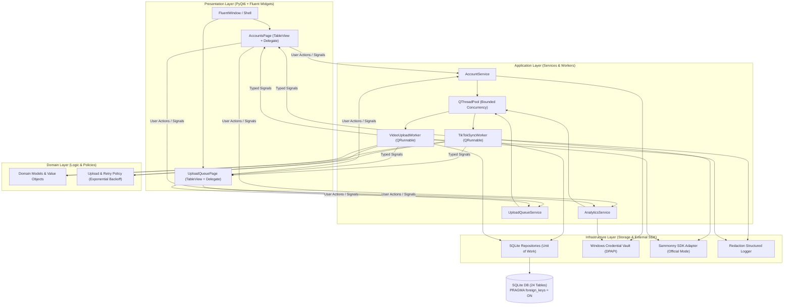

# TikTok Account & Video Manager (TAVM)

[](https://www.python.org/)
[](https://qfluentwidgets.com/)
[-blueviolet.svg)](https://sqlite.org/)
[](docs/05_security/security_and_compliance.md)
[](docs/01_architecture/system_overview.md)

Ứng dụng desktop chuẩn công nghiệp dành cho Windows 11, chuyên biệt cho quản lý tài khoản TikTok số lượng lớn, theo dõi chỉ số tăng trưởng (Analytics) được ủy quyền và điều phối hàng đợi tải lên video (Upload Queue) tự động.

---

## 📑 Mục Lục Tài Liệu Kỹ Thuật (Documentation Map)

Hệ thống tài liệu được thiết kế theo chuẩn **Diátaxis Framework** kết hợp quy trình công nghiệp **ECC (Enterprise-grade Coding Companion)**:

| Phân Hệ Tài Liệu | Thư Mục / Liên Kết | Nội Dung Chi Tiết |
| :--- | :--- | :--- |
| **00. Tổng quan & Cốt lõi** | [PROJECT_SPEC.md](file:///d:/TictokUpload411/PROJECT_SPEC.md) | Bản đặc tả tổng thể hợp nhất và định hướng kỹ thuật toàn dự án |
| **01. Kiến trúc Hệ thống** | [docs/01_architecture/](file:///d:/TictokUpload411/docs/01_architecture/system_overview.md) | Clean Architecture 4 tầng, C4 diagrams, Thread Boundaries, ADRs |
| **02. Đặc tả Kỹ thuật** | [docs/02_specifications/](file:///d:/TictokUpload411/docs/02_specifications/) | Schema 24 bảng CSDL, UI/UX 28 cột Fluent, Phân nhóm Profile, Kho Proxy hàng loạt, SDK Tri-Modal |
| **03. Kế hoạch & Phân rã Tác vụ**| [docs/03_work_breakdown/](file:///d:/TictokUpload411/docs/03_work_breakdown/wbs_and_roadmap.md)| WBS, DAG, 20 Tasks chi tiết chia 5 Sprint với DoD và TDD specs |
| **04. Hướng dẫn & Vận hành** | [docs/04_guides/](file:///d:/TictokUpload411/docs/04_guides/development_setup.md) | Cài đặt môi trường phát triển, Quy trình kiểm định 6 Pha tự động |
| **05. An ninh & Bảo mật** | [docs/05_security/](file:///d:/TictokUpload411/docs/05_security/security_and_compliance.md) | Chuẩn AgentShield, Windows Credential Manager (DPAPI), Redaction Logging |

---

## 🏛️ Sơ Đồ Kiến Trúc Tổng Quan (Architecture Overview)



---

## ⚡ Bắt Đầu Nhanh (Quick Start)

### Yêu Cầu Tiên Quyết
- Hệ điều hành: **Windows 10 / 11 64-bit**
- Môi trường: **Python 3.11+**
- CSDL: SQLite 3.38+ (được tích hợp sẵn trong Python)

### Cài Đặt Môi Trường Phát Triển
```powershell
# 1. Tạo và kích hoạt môi trường ảo
python -m venv .venv
.venv\Scripts\Activate.ps1

# 2. Cài đặt dependencies chuẩn
pip install --upgrade pip
pip install -r requirements.txt

# 3. Chạy kiểm tra linting và type check
ruff check .
mypy --strict app/ application/ domain/ infrastructure/

# 4. Chạy kiểm thử tự động
pytest -v
```

---

## 🚦 Trạng Thái Dự Án (Project Status & Gateways)

- **Quy mô (Right-Sizing Tier):** **Tier 4 — Large**
- **Trạng thái hiện tại:** **GATE 1 (Plan Approval Completed)** $\rightarrow$ Sẵn sàng triển khai **Sprint 1 (EPIC 1)**.
- **Tiến độ WBS:** 0/20 Tasks (Sẵn sàng khởi động Sprint 1).

