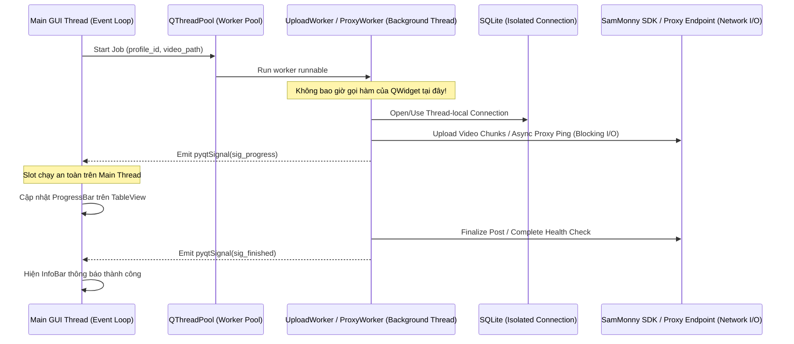

# Kiến Trúc Hệ Thống (System Architecture Overview)

Tài liệu này giải thích chi tiết kiến trúc phần mềm, nguyên tắc phân tầng và ranh giới trách nhiệm của ứng dụng **TikTok Account & Video Manager (TAVM)**.

---

## 1. Triết Lý Thiết Kế & Clean Architecture

Hệ thống được thiết kế theo nguyên lý **Clean Architecture** kết hợp mô hình **Ports and Adapters (Hexagonal)**, đảm bảo khả năng mở rộng, dễ kiểm thử (Testability) và không phụ thuộc vào framework bên ngoài:

```mermaid
flowchart TD
    subgraph L1 ["Presentation Layer (PyQt6 + Fluent Widgets)"]
        UI_WIN["MainWindow (FluentWindow)"]
        UI_ACC["AccountsPage (TableView + Delegates)"]
        UI_Q["UploadQueuePage (TableView + Delegates)"]
        UI_DLG["Dialogs (ProjectManager, ProxyManager, VideoConfig)"]
    end

    subgraph L2 ["Application Layer (Services & Concurrency Dispatcher)"]
        SVC_ACC["AccountService"]
        SVC_PROJ["ProjectService (Phân nhóm chiến dịch)"]
        SVC_PROXY["ProxyService (Kho proxy hàng loạt & Health Check)"]
        SVC_STATS["AnalyticsService"]
        SVC_Q["UploadQueueService"]
        SIG_BUS["AppSignalBus (Typed Qt Signals)"]
        POOL["QThreadPool (Bounded Concurrency = 5)"]
        WRK_SYNC["TikTokSyncWorker (QRunnable)"]
        WRK_UP["VideoUploadWorker (QRunnable)"]
        WRK_PROXY["ProxyCheckWorker (QRunnable)"]
    end

    subgraph L3 ["Domain Layer (Core Logic & Policies)"]
        ENT_ACC["Profile Entity"]
        ENT_PROJ["Project Entity"]
        ENT_PROXY["Proxy Entity"]
        ENT_JOB["VideoJob Entity"]
        POL_RETRY["RetryPolicy (Exponential Backoff + Jitter)"]
        POL_VAL["VideoValidationPolicy (SHA256, Size, Format)"]
        POL_LEAK["NetworkLeakPolicy (Critical IP Leak Guard)"]
        EXC["AppDomainExceptions Hierarchy"]
    end

    subgraph L4 ["Infrastructure Layer (External Adapters & Storage)"]
        DB_CONN["SQLite Connection Manager (WAL, FK=ON)"]
        REPO_ACC["ProfileRepository"]
        REPO_PROJ["ProjectRepository"]
        REPO_PROXY["ProxyRepository"]
        REPO_Q["QueueRepository"]
        REPO_STATS["StatsRepository"]
        VAULT["Windows Credential Vault (DPAPI / keyring)"]
        ADAPT_SDK["SamMonny TikTok Adapter (Tri-Modal Pipeline)"]
        GEO_MMDB["Offline GeoIP2 (MaxMind City & ASN MMDB)"]
        LOG_RED["Redaction Structured Logger"]
    end

    %% Presentation to Application
    UI_WIN & UI_ACC & UI_Q & UI_DLG -->|User Actions / Method Calls| SVC_ACC & SVC_PROJ & SVC_PROXY & SVC_STATS & SVC_Q
    
    %% Application to Concurrency
    SVC_ACC & SVC_STATS & SVC_Q & SVC_PROXY --> POOL
    POOL --> WRK_SYNC & WRK_UP & WRK_PROXY

    %% Workers to Domain
    WRK_SYNC & WRK_UP & WRK_PROXY --> ENT_ACC & ENT_PROJ & ENT_PROXY & ENT_JOB & POL_RETRY & POL_VAL & POL_LEAK & EXC

    %% Workers to Infrastructure
    WRK_SYNC & WRK_UP --> ADAPT_SDK
    WRK_PROXY --> GEO_MMDB
    WRK_SYNC & WRK_UP & WRK_PROXY --> REPO_ACC & REPO_PROJ & REPO_PROXY & REPO_Q & REPO_STATS
    SVC_ACC & SVC_PROXY --> VAULT

    %% Repositories to DB
    REPO_ACC & REPO_PROJ & REPO_PROXY & REPO_Q & REPO_STATS --> DB_CONN

    %% Asynchronous Signals Return Path
    WRK_SYNC & WRK_UP & WRK_PROXY -->|Emit Signals| SIG_BUS
    SIG_BUS -->|Qt Slots Dispatch (Main Thread)| UI_ACC & UI_Q & UI_WIN
    WRK_SYNC & WRK_UP & WRK_PROXY --> LOG_RED
```

---

## 2. Trách Nhiệm Chi Tiết Từng Tầng (Layer Responsibilities)

### 2.1 Tầng Hiển Thị (Presentation Layer)
- **Công nghệ**: `PyQt6` kết hợp `PyQt-Fluent-Widgets`.
- **Trách nhiệm**:
  - Dựng giao diện Windows 11 Fluent: Sidebar điều hướng, CommandBar, Bảng kép, Dialogs.
  - Quản lý trạng thái hiển thị của các bảng thông qua `QAbstractTableModel`.
  - Hộp thoại quản trị phân hệ: `ProjectManagerDialog` (quản lý nhóm dự án), `ProxyManagerDialog` (nạp và kiểm tra hàng loạt proxy).
  - Bắt sự kiện người dùng (click, filter, search, context menu) và chuyển giao cho Application Services.
  - Lắng nghe tín hiệu từ `AppSignalBus` để cập nhật giao diện trên Main GUI Thread.
- **Ranh giới nghiêm ngặt**:
  - Tuyệt đối **KHÔNG** gọi I/O mạng hoặc truy vấn CSDL trực tiếp trong code UI.
  - Tuyệt đối **KHÔNG** chứa logic tính toán nghiệp vụ (business rules).

### 2.2 Tầng Ứng Dụng (Application Layer)
- **Trách nhiệm**:
  - Điều phối luồng nghiệp vụ (Use Cases):
    * `AccountService`: Quản lý hồ sơ tài khoản và định danh.
    * `ProjectService`: Quản lý phân nhóm chiến dịch, gán nhóm hàng loạt, thống kê hiệu suất theo dự án (Xem [profile_grouping_and_projects.md](file:///d:/TictokUpload411/docs/02_specifications/profile_grouping_and_projects.md)).
    * `ProxyService`: Quản lý kho proxy hàng loạt, phân tích định dạng, kiểm tra sức khỏe mạng async, chống rò rỉ IP và xoay IP tự động (Xem [bulk_proxy_management.md](file:///d:/TictokUpload411/docs/02_specifications/bulk_proxy_management.md)).
    * `UploadQueueService`: Điều phối hàng đợi xuất bản video tự động.
    * `AnalyticsService`: Đồng bộ và tổng hợp dữ liệu phân tích kênh.
  - Khởi tạo và quản lý vòng đời của các worker thread (`QRunnable`).
  - Giao tiếp xuyên tầng bằng cơ chế phát tín hiệu (`pyqtSignal`) với các payload được định kiểu (`@dataclass(frozen=True)`).
  - Quản lý hồ sơ định danh và mật khẩu proxy trong Windows Vault.

### 2.3 Tầng Nghiệp Vụ Cốt Lõi (Domain Layer)
- **Trách nhiệm**:
  - Chứa các thực thể cốt lõi (`Profile`, `Project`, `Proxy`, `VideoJob`, `MetricSnapshot`).
  - Thực thi các quy tắc chính sách:
    * Thuật toán thử lại lũy thừa (Exponential Backoff with Jitter).
    * Chính sách kiểm tra định dạng media và trùng lặp mã băm SHA256.
    * Chính sách phòng thủ rò rỉ mạng (`NetworkLeakPolicy`): Ngắt ngay proxy khi phát hiện trùng IP thật.
  - Định nghĩa hệ thống ngoại lệ phân cấp (`AppError`, `AuthRequiredError`, `QuotaExceededError`, `CriticalIpLeakError`).
- **Đặc điểm**: Độc lập 100% với các thư viện bên ngoài (Zero dependencies trên Qt, SQLite hay SDK).

### 2.4 Tầng Hạ Tầng (Infrastructure Layer)
- **Trách nhiệm**:
  - Kết nối và quản lý giao dịch CSDL SQLite (Unit of Work, WAL, foreign_keys=ON).
  - Tương tác với Windows Credential Manager thông qua DPAPI bảo vệ token và mật khẩu proxy.
  - Tích hợp với `sammonny` SDK phiên bản 1.8.1/1.2.0 theo pipeline đa trạng thái (Official Direct Post, Cookie Hybrid TOS 5MB, Headless Studio).
  - Tra cứu vị trí địa lý & múi giờ IANA qua MaxMind GeoLite2 cục bộ (<0.1ms, 0 MB mạng).
  - Ghi nhật ký cấu trúc (Structured Logging) với bộ lọc tự động che mờ dữ liệu nhạy cảm.

---

## 3. Ranh Giới Đa Luồng & An Toàn Bộ Nhớ (Thread Boundaries)

Để tránh hiện tượng đơ giao diện (GUI Freeze) hoặc lỗi Access Violation khi cập nhật UI từ thread con:



---

## 4. Tham Chiếu Các Quyết Định Kiến Trúc & Đặc Tả Phân Hệ

- [ADR-0001: Lựa chọn PyQt6 & PyQt-Fluent-Widgets](file:///d:/TictokUpload411/docs/01_architecture/adr/0001-ui-framework-selection.md)
- [ADR-0002: Bảo tồn nguyên trạng 24 bảng CSDL SQLite](file:///d:/TictokUpload411/docs/01_architecture/adr/0002-database-preservation.md)
- [ADR-0003: Quản lý bí mật bằng Windows Credential Manager (DPAPI)](file:///d:/TictokUpload411/docs/01_architecture/adr/0003-secrets-management-vault.md)
- [ADR-0004: Mô hình đa luồng QThreadPool và Signal Bus](file:///d:/TictokUpload411/docs/01_architecture/adr/0004-async-worker-thread-model.md)
- [ADR-0005: Tích hợp SamMonny Tri-Modal Pipeline](file:///d:/TictokUpload411/docs/01_architecture/adr/0005-official-sdk-mode.md)
- [Đặc tả Phân Nhóm Profile & Dự Án](file:///d:/TictokUpload411/docs/02_specifications/profile_grouping_and_projects.md)
- [Đặc tả Quản Lý Hàng Loạt Proxy & Sức Khỏe Mạng](file:///d:/TictokUpload411/docs/02_specifications/bulk_proxy_management.md)
