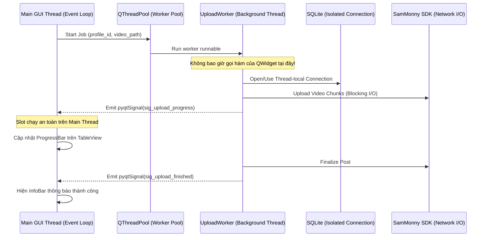

# Kiến Trúc Hệ Thống (System Architecture Overview)

Tài liệu này giải thích chi tiết kiến trúc phần mềm, nguyên tắc phân tầng và ranh giới trách nhiệm của ứng dụng **TikTok Account & Video Manager (TAVM)**.

---

## 1. Triết Lý Thiết Kế & Clean Architecture

Hệ thống được thiết kế theo nguyên lý **Clean Architecture** kết hợp mô hình **Ports and Adapters (Hexagonal)**, đảm bảo khả năng mở rộng, dễ kiểm thử (Testability) và không phụ thuộc vào framework bên ngoài:

```mermaid
flowchart TD
    subgraph L1 ["Presentation Layer (PyQt6 + Fluent Widgets)"]
        UI_WIN["MainWindow (FluentWindow)"]
        UI_ACC["AccountsPage (TableView + Delegates)"]
        UI_Q["UploadQueuePage (TableView + Delegates)"]
        UI_DLG["Dialogs (Add, Import, Config)"]
    end

    subgraph L2 ["Application Layer (Services & Concurrency Dispatcher)"]
        SVC_ACC["AccountService"]
        SVC_STATS["AnalyticsService"]
        SVC_Q["UploadQueueService"]
        SIG_BUS["AppSignalBus (Typed Qt Signals)"]
        POOL["QThreadPool (Bounded Concurrency = 5)"]
        WRK_SYNC["TikTokSyncWorker (QRunnable)"]
        WRK_UP["VideoUploadWorker (QRunnable)"]
    end

    subgraph L3 ["Domain Layer (Core Logic & Policies)"]
        ENT_ACC["Profile Entity"]
        ENT_JOB["VideoJob Entity"]
        POL_RETRY["RetryPolicy (Exponential Backoff + Jitter)"]
        POL_VAL["VideoValidationPolicy (SHA256, Size, Format)"]
        EXC["AppDomainExceptions Hierarchy"]
    end

    subgraph L4 ["Infrastructure Layer (External Adapters & Storage)"]
        DB_CONN["SQLite Connection Manager (WAL, FK=ON)"]
        REPO_ACC["ProfileRepository"]
        REPO_Q["QueueRepository"]
        REPO_STATS["StatsRepository"]
        VAULT["Windows Credential Vault (DPAPI / keyring)"]
        ADAPT_SDK["SamMonny TikTok Adapter (Official Mode Only)"]
        LOG_RED["Redaction Structured Logger"]
    end

    %% Presentation to Application
    UI_WIN & UI_ACC & UI_Q & UI_DLG -->|User Actions / Method Calls| SVC_ACC & SVC_STATS & SVC_Q
    
    %% Application to Concurrency
    SVC_ACC & SVC_STATS & SVC_Q --> POOL
    POOL --> WRK_SYNC & WRK_UP

    %% Workers to Domain
    WRK_SYNC & WRK_UP --> ENT_ACC & ENT_JOB & POL_RETRY & POL_VAL & EXC

    %% Workers to Infrastructure
    WRK_SYNC & WRK_UP --> ADAPT_SDK
    WRK_SYNC & WRK_UP --> REPO_ACC & REPO_Q & REPO_STATS
    SVC_ACC --> VAULT

    %% Repositories to DB
    REPO_ACC & REPO_Q & REPO_STATS --> DB_CONN

    %% Asynchronous Signals Return Path
    WRK_SYNC & WRK_UP -->|Emit Signals| SIG_BUS
    SIG_BUS -->|Qt Slots Dispatch (Main Thread)| UI_ACC & UI_Q & UI_WIN
    WRK_SYNC & WRK_UP --> LOG_RED
```

---

## 2. Trách Nhiệm Chi Tiết Từng Tầng (Layer Responsibilities)

### 2.1 Tầng Hiển Thị (Presentation Layer)
- **Công nghệ**: `PyQt6` kết hợp `PyQt-Fluent-Widgets`.
- **Trách nhiệm**:
  - Dựng giao diện Windows 11 Fluent: Sidebar điều hướng, CommandBar, Bảng kép, Dialogs.
  - Quản lý trạng thái hiển thị của các bảng thông qua `QAbstractTableModel`.
  - Bắt sự kiện người dùng (click, filter, search, context menu) và chuyển giao cho Application Services.
  - Lắng nghe tín hiệu từ `AppSignalBus` để cập nhật giao diện trên Main GUI Thread.
- **Ranh giới nghiêm ngặt**:
  - Tuyệt đối **KHÔNG** gọi I/O mạng hoặc truy vấn CSDL trực tiếp trong code UI.
  - Tuyệt đối **KHÔNG** chứa logic tính toán nghiệp vụ (business rules).

### 2.2 Tầng Ứng Dụng (Application Layer)
- **Trách nhiệm**:
  - Điều phối luồng nghiệp vụ (Use Cases): Thêm profile, bắt đầu hàng đợi, đồng bộ chỉ số.
  - Khởi tạo và quản lý vòng đời của các worker thread (`QRunnable`).
  - Giao tiếp xuyên tầng bằng cơ chế phát tín hiệu (`pyqtSignal`) với các payload được định kiểu (`@dataclass(frozen=True)`).
  - Quản lý hồ sơ định danh trong Windows Vault.

### 2.3 Tầng Nghiệp Vụ Cốt Lõi (Domain Layer)
- **Trách nhiệm**:
  - Chứa các thực thể cốt lõi (`Profile`, `VideoJob`, `MetricSnapshot`).
  - Thực thi các quy tắc chính sách: Thuật toán thử lại lũy thừa (Exponential Backoff), chính sách kiểm tra định dạng media, kiểm tra trùng lặp mã băm SHA256.
  - Định nghĩa hệ thống ngoại lệ phân cấp (`AppError`, `AuthRequiredError`, `QuotaExceededError`).
- **Đặc điểm**: Độc lập 100% với các thư viện bên ngoài (Zero dependencies trên Qt, SQLite hay SDK).

### 2.4 Tầng Hạ Tầng (Infrastructure Layer)
- **Trách nhiệm**:
  - Kết nối và quản lý giao dịch CSDL SQLite (Unit of Work).
  - Tương tác với Windows Credential Manager thông qua DPAPI.
  - Tích hợp với `sammonny` SDK phiên bản 1.8.1 theo giao thức chính thức.
  - Ghi nhật ký cấu trúc (Structured Logging) với bộ lọc tự động che mờ dữ liệu nhạy cảm.

---

## 3. Ranh Giới Đa Luồng & An Toàn Bộ Nhớ (Thread Boundaries)

Để tránh hiện tượng đơ giao diện (GUI Freeze) hoặc lỗi Access Violation khi cập nhật UI từ thread con:



---

## 4. Tham Chiếu Các Quyết Định Kiến Trúc (ADRs)

Toàn bộ các quyết định kỹ thuật then chốt được lưu trữ độc lập:
- [ADR-0001: Lựa chọn PyQt6 & PyQt-Fluent-Widgets](file:///d:/TictokUpload411/docs/01_architecture/adr/0001-ui-framework-selection.md)
- [ADR-0002: Bảo tồn nguyên trạng 24 bảng CSDL SQLite](file:///d:/TictokUpload411/docs/01_architecture/adr/0002-database-preservation.md)
- [ADR-0003: Quản lý bí mật bằng Windows Credential Manager (DPAPI)](file:///d:/TictokUpload411/docs/01_architecture/adr/0003-secrets-management-vault.md)
- [ADR-0004: Mô hình đa luồng QThreadPool và Signal Bus](file:///d:/TictokUpload411/docs/01_architecture/adr/0004-async-worker-thread-model.md)
- [ADR-0005: Tích hợp SamMonny SDK theo chế độ Official API](file:///d:/TictokUpload411/docs/01_architecture/adr/0005-official-sdk-mode.md)

