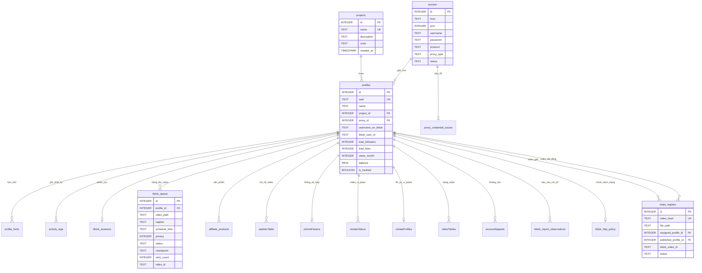

# Đặc Tả CSDL SQLite — 24 Bảng Kế Thừa (Database Schema Catalog)

Tài liệu này là đặc tả tham chiếu máy (Machine Reference) cho toàn bộ 24 bảng dữ liệu SQLite kế thừa từ các migration nguồn và DDL runtime.

---

## 1. Sơ Đồ Thực Thể Liên Kết (Mermaid ERD)

---

## 2. Chi Tiết Danh Mục 24 Bảng Dữ Liệu

### Bảng 1: `projects`
- **Mục đích**: Phân nhóm hồ sơ theo chiến dịch hoặc danh mục.
- **Cột**:
  - `id`: `INTEGER PRIMARY KEY AUTOINCREMENT`
  - `name`: `TEXT NOT NULL UNIQUE`
  - `description`: `TEXT`
  - `color`: `TEXT` (Mã màu HEX phục vụ UI badge)
  - `created_at`: `TIMESTAMP DEFAULT CURRENT_TIMESTAMP`

### Bảng 2: `proxies`
- **Mục đích**: Quản lý thông tin kết nối proxy.
- **Cột**:
  - `id`: `INTEGER PRIMARY KEY AUTOINCREMENT`
  - `host`: `TEXT NOT NULL`, `port`: `INTEGER NOT NULL`
  - `username`: `TEXT`, `password`: `TEXT`
  - `protocol`: `TEXT CHECK(protocol IN ('http', 'https', 'socks5'))`
  - `proxy_type`: `TEXT CHECK(proxy_type IN ('static', 'rotating', 'mobile'))`
  - `status`: `TEXT DEFAULT 'active'`
  - `latency_ms`: `INTEGER`, `public_ip`: `TEXT`, `country_code`: `TEXT`
  - `city`: `TEXT`, `isp`: `TEXT`, `timezone`: `TEXT`
  - `latitude`: `REAL`, `longitude`: `REAL`, `change_ip_url`: `TEXT`
  - `error_message`: `TEXT`, `udp_supported`: `INTEGER DEFAULT 0`
  - `last_checked_at`: `TIMESTAMP`, `created_at`: `TIMESTAMP DEFAULT CURRENT_TIMESTAMP`
- **Ràng buộc**: `UNIQUE(host, port, username)`

### Bảng 3: `profiles` (Bảng Lõi Trung Tâm)
- **Mục đích**: Lưu trữ thông tin định danh hồ sơ, tài khoản TikTok và thông số trình duyệt.
- **Cột**:
  - `id`: `INTEGER PRIMARY KEY AUTOINCREMENT`
  - `uuid`: `TEXT NOT NULL UNIQUE`
  - `name`: `TEXT NOT NULL`
  - `project_id`: `INTEGER REFERENCES projects(id) ON DELETE SET NULL`
  - `proxy_id`: `INTEGER REFERENCES proxies(id) ON DELETE SET NULL`
  - `storage_dir`: `TEXT`, `status`: `TEXT DEFAULT 'new'`
  - `user_agent`: `TEXT`, `os_type`: `TEXT`, `resolution`: `TEXT`
  - `device_pixel_ratio`: `REAL`, `cpu_cores`: `INTEGER`, `memory_gb`: `INTEGER`
  - `canvas_noise`: `REAL`, `audio_noise`: `REAL`, `client_rects_noise`: `REAL`
  - `webgl_vendor`: `TEXT`, `webgl_renderer`: `TEXT`, `webgl_noise`: `REAL`
  - `webrtc_mode`: `TEXT`, `timezone_id`: `TEXT`, `color_scheme`: `TEXT`
  - `language_mode`: `TEXT`, `languages`: `TEXT`, `latitude`: `REAL`, `longitude`: `REAL`
  - `cookies_json`: `TEXT`, `notes`: `TEXT`, `auth_2fa`: `TEXT`
  - `is_trashed`: `BOOLEAN DEFAULT 0`, `created_at`: `TIMESTAMP`, `updated_at`: `TIMESTAMP`
  - `country`: `TEXT`, `currency`: `TEXT`, `vpn_config`: `TEXT`
  - `rx_bytes`: `INTEGER`, `tx_bytes`: `INTEGER`, `user_extensions`: `TEXT`
  - `cookies_browser`: `TEXT`, `username_on_tiktok`: `TEXT`, `tiktok_user_id`: `TEXT`
  - `nickname`: `TEXT`, `avatar_url`: `TEXT`, `avatar_path`: `TEXT`
  - `total_followers`: `INTEGER DEFAULT 0`, `total_following`: `INTEGER DEFAULT 0`
  - `total_likes`: `INTEGER DEFAULT 0`, `total_videos`: `INTEGER DEFAULT 0`
  - `state_loggin_browser`: `INTEGER DEFAULT 0`, `email`: `TEXT`, `password`: `TEXT`
  - `uore`: `TEXT`, `reup_from`: `TEXT`, `state_kyc`: `TEXT`
  - `money_earned`: `REAL DEFAULT 0.0`, `rpm`: `REAL DEFAULT 0.0`, `balance`: `REAL DEFAULT 0.0`
  - `views_month`: `INTEGER DEFAULT 0`, `date_reapply`: `TEXT`, `appealViolateDate`: `TEXT`
  - `ttl_violations`: `TEXT`, `last_password`: `TEXT`, `old_password`: `TEXT`
  - `device_params`: `TEXT`, `tags`: `TEXT`, `totp_secret`: `TEXT`, `tax_info`: `TEXT`
  - `total_views`: `INTEGER DEFAULT 0`, `statistic_date_update`: `TEXT`, `vat`: `TEXT`
  - `sec_uid`: `TEXT`, `paypal_identity`: `TEXT`, `minimum_pay`: `REAL`
  - `folder_upload`: `TEXT`, `music_bypass`: `TEXT`, `email_backup`: `TEXT`
  - `email_backup_password`: `TEXT`, `account_standing`: `TEXT`, `strike_count`: `INTEGER DEFAULT 0`
  - `shadowban_status`: `TEXT`, `shadowban_reasons`: `TEXT`, `sdb`: `TEXT`, `privacy`: `INTEGER`
  - `total_penalty_points`: `INTEGER DEFAULT 0`, `penalty_expire_date`: `TEXT`
  - `account_appeal_status`: `TEXT`, `money_month`: `REAL DEFAULT 0.0`, `note_color`: `TEXT`
  - `bio`: `TEXT`, `user_rate`: `INTEGER`, `commerce_user_level`: `INTEGER`
  - `can_be_live_podcast`: `INTEGER`, `bind_phone`: `INTEGER`, `has_email`: `INTEGER`
  - `channel_verdict`: `TEXT`

### Bảng 4: `profile_fonts`
- **Mục đích**: Quản lý font cài đặt trong profile.
- **Cột**: `id` INTEGER PK, `profile_id` INTEGER FK `profiles(id) ON DELETE CASCADE`, `font_name` TEXT.
- **Ràng buộc**: `UNIQUE(profile_id, font_name)`.

### Bảng 5: `activity_logs`
- **Mục đích**: Ghi nhật ký thao tác trên profile.
- **Cột**: `id` INTEGER PK, `profile_id` INTEGER FK `profiles(id) ON DELETE CASCADE`, `action` TEXT, `details` TEXT, `created_at` TIMESTAMP.

### Bảng 6: `proxy_credential_issues`
- **Mục đích**: Lưu trữ lỗi xác thực proxy.
- **Cột**: `proxy_id` INTEGER PK FK `proxies(id) ON DELETE CASCADE`, `reason` TEXT, `detected_at` TEXT.

### Bảng 7: `tiktok_sessions`
- **Mục đích**: Lưu phiên làm việc trình duyệt.
- **Cột**: `profile_id` INTEGER PK FK `profiles(id) ON DELETE CASCADE`, `cookies_json` TEXT, `updated_at` TIMESTAMP.

### Bảng 8: `tiktok_queue` (Bảng Lõi Hàng Đợi Upload)
- **Mục đích**: Hàng đợi xuất bản video tự động và theo lịch.
- **Cột**:
  - `id`: `INTEGER PRIMARY KEY AUTOINCREMENT`
  - `profile_id`: `INTEGER NOT NULL REFERENCES profiles(id) ON DELETE CASCADE`
  - `video_path`: `TEXT NOT NULL`, `caption`: `TEXT`, `schedule_time`: `TEXT`
  - `privacy`: `INTEGER DEFAULT 0` (0: Public, 1: Friends, 2: Private)
  - `allow_comment`: `INTEGER DEFAULT 1`, `allow_duet`: `INTEGER DEFAULT 1`, `allow_stitch`: `INTEGER DEFAULT 1`
  - `affiliate_product_id`: `TEXT`, `error_reason`: `TEXT`, `uploaded_on`: `TEXT`
  - `video_id`: `TEXT`, `screenshot_path`: `TEXT`, `thumbnail_ratio`: `REAL`
  - `allow_hd`: `INTEGER DEFAULT 1`, `is_ai_generated`: `INTEGER DEFAULT 0`
  - `created_at`: `TIMESTAMP DEFAULT CURRENT_TIMESTAMP`, `video_hash`: `TEXT`
  - `checkpoint`: `TEXT`, `upload_mode`: `TEXT DEFAULT 'official_direct_post'`
  - `schedule_day_key`: `TEXT`, `scheduled_slot`: `TEXT`, `retry_count`: `INTEGER DEFAULT 0`
  - `next_retry_at`: `REAL`, `music_id`: `TEXT`, `music_title`: `TEXT`
  - `status`: `TEXT CHECK(status IN ('pending', 'uploading', 'done', 'failed')) DEFAULT 'pending'`

### Bảng 9: `affiliate_products`
- **Mục đích**: Quản lý sản phẩm gắn kèm video.
- **Cột**: `id` INTEGER PK, `profile_id` INTEGER FK `profiles(id) ON DELETE CASCADE`, `product_id` TEXT, `title` TEXT, `commission` REAL, `price` REAL, `url` TEXT, `created_at` TIMESTAMP. UNIQUE `(profile_id, product_id)`.

### Bảng 10: `statisticTable`
- **Mục đích**: Chỉ số chi tiết từng video theo profile.
- **Cột**: `id` INTEGER PK, `profile_id` INTEGER FK `profiles(id) ON DELETE CASCADE`, `id_video` TEXT, `title` TEXT, `views` INTEGER, `likes` INTEGER, `comments` INTEGER, `shares` INTEGER, `saves` INTEGER, `downloads` INTEGER, `reposts` INTEGER, `whatsapp_shares` INTEGER, `engagement_rate` REAL, `traffic_flow` TEXT, `date_upload` TEXT, `red_line` INTEGER, `status` TEXT, `updated_at` TIMESTAMP. UNIQUE `(profile_id, id_video)`.

### Bảng 11: `phoneParams`
- **Mục đích**: Thông số giả lập thiết bị di động.
- **Cột**: `id` INTEGER PK, `profile_id` INTEGER UNIQUE FK `profiles(id) ON DELETE CASCADE`, `device_id` TEXT, `iid` TEXT, `openudid` TEXT, `cdid` TEXT, `device_type` TEXT, `device_brand` TEXT, `model` TEXT, `os_version` TEXT, `resolution` TEXT, `dpi` TEXT, `mcc_mnc` TEXT, `user_agent` TEXT, `timezone_name` TEXT, `created_at` TIMESTAMP.

### Bảng 12: `violateVideos`
- **Mục đích**: Danh mục video bị vi phạm chính sách nội dung.
- **Cột**: `id` INTEGER PK, `profile_id` INTEGER FK `profiles(id) ON DELETE CASCADE`, `video_id` TEXT, `title` TEXT, `violate_title` TEXT, `violate_description` TEXT, `video_posted_date` TEXT, `appeal_date` TEXT, `status` TEXT, `created_at` TIMESTAMP, `display` INTEGER, `appeal_status` TEXT, `reason` TEXT. UNIQUE `(profile_id, video_id)`.

### Bảng 13: `violateProfiles`
- **Mục đích**: Cảnh báo vi phạm cấp độ tài khoản.
- **Cột**: `id` INTEGER PK, `profile_id` INTEGER UNIQUE FK `profiles(id) ON DELETE CASCADE`, `violate_title` TEXT, `violate_description` TEXT, `created_at` TIMESTAMP.

### Bảng 14: `videoTables`
- **Mục đích**: Quản lý siêu dữ liệu video đã đăng tải.
- **Cột**: `id` INTEGER PK, `profile_id` INTEGER FK `profiles(id) ON DELETE CASCADE`, `video_id` TEXT, `title` TEXT, `views` INTEGER, `likes` INTEGER, `comments` INTEGER, `shares` INTEGER, `saves` INTEGER, `downloads` INTEGER, `reposts` INTEGER, `whatsapp_shares` INTEGER, `engagement_rate` REAL, `traffic_flow` TEXT, `duration` INTEGER, `display` INTEGER, `schedule` TEXT, `upload_to` TEXT, `status` TEXT, `thumbnail_url` TEXT, `allow_comment` INTEGER, `allow_duet` INTEGER, `allow_stitch` INTEGER, `is_pinned` INTEGER, `created_at` TIMESTAMP. UNIQUE `(profile_id, video_id)`.

### Bảng 15: `accountAppeals`
- **Mục đích**: Quản lý trạng thái khiếu nại tài khoản và video.
- **Cột**: `id` INTEGER PK, `profile_id` INTEGER FK `profiles(id) ON DELETE CASCADE`, `appeal_type` TEXT, `object_id` TEXT, `reason` TEXT, `contact_email` TEXT, `evidence_urls` TEXT, `status` TEXT, `notes` TEXT, `submitted_at` TIMESTAMP, `updated_at` TIMESTAMP.

### Bảng 16: `tiktok_report_observations`
- **Mục đích**: Lưu snapshot quan sát báo cáo gần nhất theo loại.
- **Cột**: `profile_id` INTEGER FK `profiles(id) ON DELETE CASCADE`, `report_kind` TEXT, `observed_at` TEXT, `source` TEXT, `status` TEXT, `payload_json` TEXT, `last_attempt_at` TEXT, `last_error` TEXT. PK ghép `(profile_id, report_kind)`.

### Bảng 17: `video_registry` (Kiểm Soát Trùng Lặp Video)
- **Mục đích**: Đăng ký mã băm SHA256 chống đăng trùng video giữa các kênh.
- **Cột**: `id` INTEGER PK, `video_hash` TEXT NOT NULL UNIQUE, `file_path` TEXT, `file_name` TEXT, `file_size` INTEGER, `mtime` REAL, `status` TEXT CHECK(status IN ('available', 'reserved', 'uploading', 'published', 'failed')), `assigned_profile_id` INTEGER REFERENCES profiles(id) ON DELETE SET NULL, `published_profile_id` INTEGER REFERENCES profiles(id) ON DELETE SET NULL, `tiktok_video_id` TEXT, `published_at` TIMESTAMP, `retry_count` INTEGER DEFAULT 0, `created_at` TIMESTAMP, `updated_at` TIMESTAMP.

### Bảng 18: `tiktok_http_policy`
- **Mục đích**: Lưu trạng thái cooldown và cờ kiểm soát tần suất kết nối.
- **Cột**: `profile_id` INTEGER PK FK `profiles(id) ON DELETE CASCADE`, `blocked_until` REAL, `manual_review` INTEGER CHECK(manual_review IN (0, 1)), `ssr_pending` INTEGER CHECK(ssr_pending IN (0, 1)).

### Bảng 19: `system_metadata`
- **Mục đích**: Lưu cấu hình hệ thống và phiên bản schema.
- **Cột**: `key` TEXT PRIMARY KEY, `value` TEXT, `updated_at` TIMESTAMP.

### Bảng 20: `video_signature`
- **Mục đích**: Lưu chữ ký khung hình và kiểm tra C2PA metadata.
- **Cột**: `user_id` TEXT, `path_key` TEXT, `path` TEXT, `duration_secs` REAL, `size_bytes` INTEGER, `frames` TEXT, `has_c2pa` INTEGER, `checked_at` REAL. PK ghép `(user_id, path_key)`.

### Bảng 21: `duplicate_check_config`
- **Mục đích**: Cấu hình tiến trình kiểm tra trùng lặp.
- **Cột**: `id` TEXT PK, `project_id` TEXT, `account_id` TEXT, `enabled` INTEGER, `check_interval_minutes` INTEGER, `max_duration_hours` INTEGER, `updated_at` REAL.

### Bảng 22: `duplicate_check_lease`
- **Mục đích**: Khóa logic ngăn hai tiến trình kiểm tra cùng tài khoản.
- **Cột**: `config_id` TEXT PK, `leased_until` REAL NOT NULL, `lease_token` TEXT NOT NULL, `updated_at` REAL NOT NULL.

### Bảng 23: `duplicate_check_log`
- **Mục đích**: Lịch sử chi tiết đối soát video trùng.
- **Cột**: `id` TEXT PK, `account_id` TEXT, `video_id` TEXT, `video_name` TEXT, `is_duplicate` INTEGER, `outcome` TEXT, `ineligible_reason` TEXT, `visibility` TEXT, `can_appeal` INTEGER, `appeal_deadline` TEXT, `checked_at` REAL NOT NULL.

### Bảng 24: `channel_quality_reports`
- **Mục đích**: Báo cáo phân tích chất lượng kênh qua Heuristic & AI.
- **Cột**: `id` TEXT PK, `account_id` TEXT NOT NULL, `scanned_at` REAL NOT NULL, `videos_total` INTEGER, `videos_analyzed` INTEGER, `metrics` TEXT NOT NULL, `heuristic` TEXT NOT NULL, `ai` TEXT, `ai_model` TEXT, `prompt_version` TEXT, `deleted_at` REAL.

---

## 3. Hệ Thống Chỉ Mục (Performance Indices)

Để đảm bảo tốc độ phản hồi < 10ms khi truy vấn bảng lớn:
1. `idx_profiles_search`: Trên `profiles(name, username_on_tiktok, status, project_id, is_trashed)`
2. `idx_queue_schedule`: Trên `tiktok_queue(status, schedule_time, profile_id)`
3. `idx_video_registry_hash`: Trên `video_registry(video_hash)`
4. `idx_stats_profile`: Trên `statisticTable(profile_id, id_video, date_upload)`
5. `idx_videotables_profile`: Trên `videoTables(profile_id, video_id, status)`

