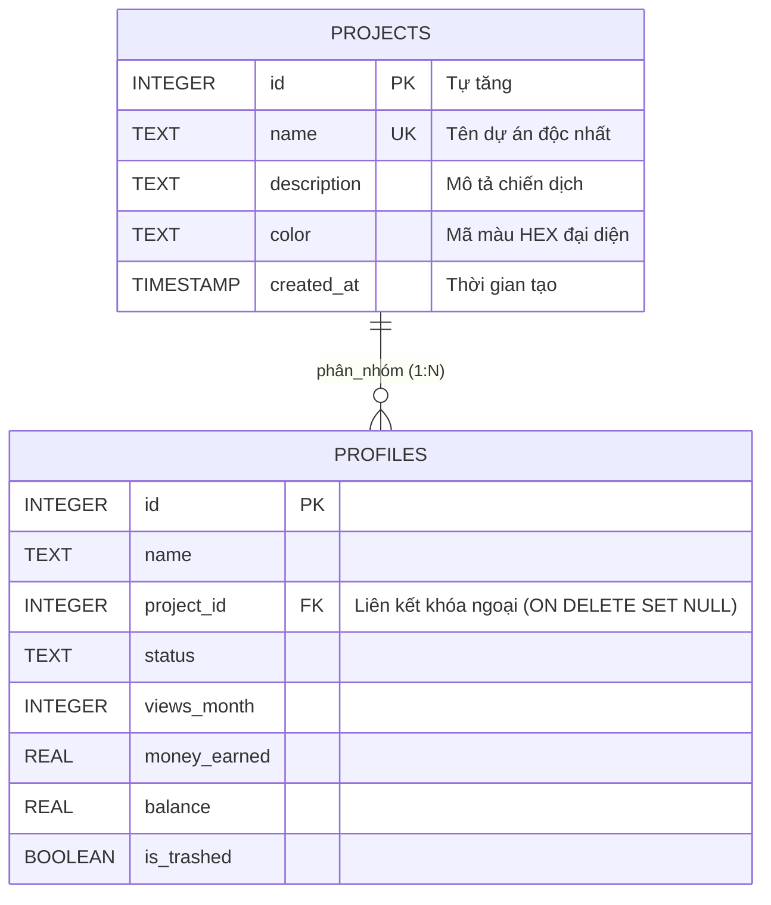

# Đặc Tả Kỹ Thuật: Quản Lý Phân Nhóm Profile & Dự Án (Profile Grouping & Projects)
## Phân Hệ: Project & Profile Grouping Subsystem (`TAVM-2026-WIN`)

Tài liệu này quy chuẩn kiến trúc và luồng tương tác của tính năng phân nhóm hồ sơ (Profile Grouping) theo chiến dịch, ngách nội dung (Niche), thị trường quốc gia hoặc nhóm vận hành.

---

## 1. Mục Tiêu Nghiệp Vụ & Bối Cảnh

Khi quy mô trang trại tài khoản TikTok tăng từ hàng chục lên hàng nghìn profile:
1. **Tránh nhầm lẫn nội dung**: Phân tách rạch ròi các kênh theo chiến dịch (ví dụ: *US_Affiliate_Q4*, *Beta_UK_Tech*, *Shop_Vlog_VN*).
2. **Quản trị đa kênh tập trung**: Cho phép lọc, khởi chạy, kiểm tra hàng loạt hoặc áp dụng cấu hình proxy riêng theo từng nhóm mà không làm ảnh hưởng đến các nhóm khác.
3. **Thống kê hiệu suất theo dự án**: Tổng hợp nhanh doanh thu quỹ sáng tạo (`$Earned`), lượt xem tháng (`Views 30d`), số nick Live/Die theo từng nhóm chiến dịch.

---

## 2. Mô Hình Dữ Liệu Quan Hệ (Database Schema & Integrity)

Phân hệ kế thừa bảng `projects` từ hệ thống migration chuẩn 3NF:



### 2.1. Mã DDL Bảng `projects`
```sql
CREATE TABLE IF NOT EXISTS projects (
    id INTEGER PRIMARY KEY AUTOINCREMENT,
    name TEXT NOT NULL UNIQUE,
    description TEXT,
    color TEXT DEFAULT '#0078D4',
    created_at TIMESTAMP DEFAULT CURRENT_TIMESTAMP
);

-- Khóa ngoại an toàn trên bảng profiles: khi xóa project, profile chuyển về NULL (Chưa phân nhóm)
-- Không làm mất dữ liệu profile của người dùng
ALTER TABLE profiles ADD COLUMN project_id INTEGER REFERENCES projects(id) ON DELETE SET NULL;
CREATE INDEX IF NOT EXISTS idx_profiles_project ON profiles(project_id);
```

### 2.2. Nhóm Mặc Định Hệ Thống (System Defaults)
- Mặc định khi cài đặt, hệ thống tự động khởi tạo bản ghi:
  - `id: 1`
  - `name: "Dự án mặc định"`
  - `color: "#0078D4"` (Windows Accent Blue)
  - `description: "Nhóm chứa tất cả các hồ sơ chưa phân loại"`

---

## 3. Các Luồng Nghiệp Vụ Quản Trị Nhóm (Business Workflows)

### 3.1. Tạo & Chỉnh Sửa Dự Án (`ProjectManagementService`)
- Người dùng có thể tạo không giới hạn số lượng nhóm.
- Mỗi nhóm sở hữu một **Mã Màu HEX (`color`)** để hiển thị huy hiệu (Color Badge) trên giao diện bảng danh sách.
- Khi cập nhật tên nhóm, hệ thống kiểm tra tính duy nhất (Unique Constraint) và đồng bộ tức thì trên toàn bộ các ComboBox lựa chọn.

### 3.2. Gán & Chuyển Nhóm Hàng Loạt (Bulk Assignment)
- Người dùng có thể chọn hàng loạt (Select All / Multi-select) hồ sơ trên Bảng 1 (Accounts Table):
  - Click chuột phải $\rightarrow$ `Chuyển sang dự án...` $\rightarrow$ Chọn nhóm đích.
  - Hệ thống thực thi giao dịch nguyên tử (Atomic Transaction):
    ```sql
    UPDATE profiles SET project_id = ? WHERE id IN (?, ?, ?, ...);
    ```
  - Cập nhật số lượng hồ sơ của nhóm tức thì mà không cần nạp lại toàn bộ CSDL.

### 3.3. Xóa Nhóm An Toàn (Safe Deletion Policy)
- Khi người dùng xóa một dự án:
  - **Không bao giờ xóa profile đi kèm**.
  - Toàn bộ profile thuộc dự án đó sẽ được chuyển về nhóm mặc định hoặc gán `project_id = NULL`.
  - Hiển thị hộp thoại cảnh báo Fluent xác nhận trước khi thực hiện.

---

## 4. Báo Cáo & Thống Kê Theo Nhóm (Project Aggregates)

Hệ thống cung cấp truy vấn phân tích tổng hợp nhanh (Analytical Aggregation Query) để hiển thị thẻ trạng thái nhóm:

```sql
SELECT 
    p.id AS project_id,
    p.name AS project_name,
    p.color AS project_color,
    COUNT(pr.id) AS total_profiles,
    SUM(CASE WHEN pr.status = 'LIVE' THEN 1 ELSE 0 END) AS live_count,
    SUM(CASE WHEN pr.status = 'DIE' THEN 1 ELSE 0 END) AS die_count,
    SUM(pr.views_month) AS total_views_30d,
    SUM(pr.money_earned) AS total_earned_usd,
    SUM(pr.balance) AS total_balance_usd
FROM projects p
LEFT JOIN profiles pr ON p.id = pr.project_id AND pr.is_trashed = 0
GROUP BY p.id;
```

---

## 5. Tương Tác Giao Diện Chuẩn Windows 11 Fluent Design

1. **Bộ chọn Dự án trên thanh công cụ đỉnh (Top Project Selector)**:
   - Sử dụng `ComboBox` Fluent bo góc mềm mại, hiển thị chấm tròn màu đại diện trước tên dự án:
     `[ (•) US_Beta_Affiliate  v ]`
   - Mục chọn đặc biệt: `Tất cả dự án` (cho phép xem toàn cảnh không lọc) và `Chưa phân nhóm`.
2. **Hộp thoại Quản lý Dự án (`ProjectManagerDialog`)**:
   - Mở nhanh qua icon bánh răng/danh mục cạnh ComboBox.
   - Danh sách thẻ Card bo góc 6px hiển thị từng nhóm:
     - Tên nhóm, số lượng profile đang có (`InfoBadge`).
     - Bảng chọn màu Fluent ColorPicker.
     - Nút Thêm mới, Đổi tên, Xóa nhóm.
3. **Bộ lọc nhanh trên Bảng 1 (Account Table Filter Chip)**:
   - Cột `Dự án` hiển thị nhãn màu tròn `Tag` nhỏ tinh tế.
   - Cho phép kéo thả trực tiếp dòng profile từ bảng vào nhóm dự án mong muốn.
