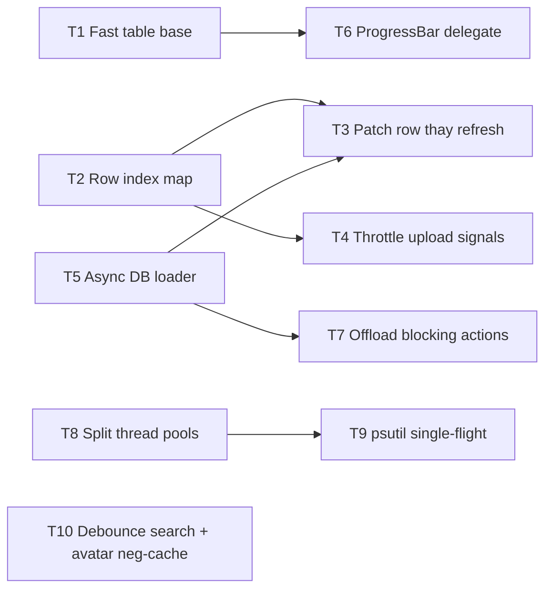

# Kế Hoạch Vá Lỗi Giao Diện Chậm / Giật / Phản Hồi Trễ (GATE 1)

> Trạng thái: **P0 (71376fe) · P1 (16c931e) · P2 hoàn tất, chờ GATE 2** · Ngày khảo sát: 2026-11-05 · Phạm vi: `src/presentation`, `src/application/workers`, `src/infrastructure/browser/orbita_launcher.py`

## 1. Số liệu đo thực tế (500 profile / 500 video, Qt offscreen)

Script đo: `scratch/perf/bench_ui.py`, `scratch/perf/try_native_delegate.py` (không thuộc app).

| Điểm nóng (chạy trên GUI thread) | Thời gian | Ngưỡng mượt |
| :--- | ---: | ---: |
| Vẽ lại 1 khung bảng Profile (Fluent `TableItemDelegate`) | **124–145 ms** | 16 ms |
| Vẽ lại 1 khung bảng Video | **105–170 ms** | 16 ms |
| ↳ cùng bảng, thay bằng delegate gốc C++ (thử nghiệm) | 77 ms | |
| `VideoTable.load_videos(500)` (500 widget `ProgressBar`) | **515 ms** | |
| `ProfileTable.load_profiles(500)` | 243 ms | |
| `profile_repo.list_active()` 500 dòng | 55 ms | |
| `profile_repo.update()` khi worker đang giữ giao dịch ghi | **980 ms** (tới 10 s nếu giao dịch dài) | 0 |
| 1 sự kiện `update_progress` / `append_log` (quét tuyến tính tìm dòng) | 5 ms / sự kiện | |

## 2. Nguyên nhân gốc (xếp theo mức ảnh hưởng)

### A. Giật khi rê chuột / bấm / chọn dòng
1. **Fluent `TableView` vẽ lại TOÀN BỘ viewport** mỗi lần đổi hover row, pressed row, selection (`qfluentwidgets/.../table_view.py:_setHoverRow/_setPressedRow/_setSelectedRows` → `viewport().update()`). Mỗi lần ~140 ms ⇒ rê chuột qua bảng = 5–7 fps; mỗi cú click = 2 lần vẽ toàn bảng (~300 ms trễ).
2. **`TableItemDelegate.paint` viết bằng Python** cho mọi ô (~0,3 ms/ô × ~470 ô hiển thị).
3. **`CircularAvatarDelegate`** gọi `Path.exists()` (stat đĩa) mỗi lần vẽ với avatar không tồn tại — kết quả "không có" không được cache (`circular_avatar_delegate.py:34`).
4. `_setSelectedRows(self.selectedIndexes())` liệt kê mọi ô đã chọn (29 cột × N dòng) mỗi lần đổi selection.

### B. Đơ cả giây khi có hoạt động nền (sync, upload, sniffer)
5. **Bão `profile_updated` → `refresh_profiles()` toàn phần** (`main_window.py:1922`). Signal phát *mỗi profile* từ 6 nguồn (channel update, metrics sync, network sniffer, passive sync ×2, avatar cache). Mỗi lần = đọc DB 55 ms + dựng lại bảng 243 ms + **hủy và phát lại** worker quét psutil (`force=True`). Batch 100 profile ⇒ ~30 s GUI đơ rải rác.
6. **Ghi SQLite trên GUI thread** trong slot `_on_profile_statuses_updated` (`main_window.py:478`) chạy mỗi 3 s; tranh `writer_lock` với worker upload ⇒ đo được 980 ms, tối đa `busy_timeout` 10 s.
7. **Tín hiệu tiến độ upload không giới hạn tần suất** (`upload_worker.py:39,44`): mỗi chunk phát 1 progress + log; mỗi sự kiện quét tuyến tính `find_row_by_video_id` 2–3 lần (`video_queue_table_widget.py:228`). Nhiều upload song song ⇒ hàng đợi sự kiện Qt nghẽn, click bị trễ.
8. **Hoàn tất upload chạy I/O nặng trên GUI**: `isolate_video_file` → `shutil.move` (khác ổ đĩa = copy cả file GB) + `video_repo.list_available()` (`main_window.py:1880-1911`).

### C. Bấm nút / mở menu phản hồi chậm
9. **Thao tác đồng bộ trên GUI thread**:
   - `_on_close_orbita` → `close_profile` → HTTP `gl.stop()` tới daemon + DB update cho từng profile.
   - `_on_rotate_proxy_selected` → `sammonny.trigger_ip_rotation` (HTTP) tuần tự từng proxy.
   - `_on_clean_browser` → dọn cache Chromium trên đĩa + quét tiến trình.
   - `refresh_profiles` / `refresh_videos` / `_refresh_project_dropdown` đọc DB đồng bộ (đổi dự án, F5, sau mỗi dialog).
   - `count_valid_videos_in_folder` → `rglob` cả cây thư mục khi thêm folder (`batch_folder_upload_dialog.py:347,380`); `dropEvent` → `rglob` (`video_queue_table_widget.py:519`).
   - 43 lời gọi repo/service trực tiếp trong `main_window.py`, 57 lời gọi trong 11 dialog.
10. **`load_videos` tạo 1 QWidget + layout + `ProgressBar` cho mỗi dòng** (515 ms/500 dòng, và mỗi widget tự vẽ/animate).
11. **Ô tìm kiếm không debounce**: lọc lại toàn bảng ở mỗi phím gõ.
12. **Một `QThreadPool` toàn cục 10 luồng cho mọi việc**: 10 upload dài (vài phút) chiếm hết luồng ⇒ worker trạng thái/import/metrics xếp hàng, người dùng thấy "bấm mà không có gì xảy ra".

### D. Ổn định (liên quan trực tiếp)
13. **Quét psutil không an toàn đa luồng**: worker cũ bị `cancel()` vẫn đang chạy `process_iter()` khi worker mới khởi động; cache `_cached_running_cmdlines` không có lock ⇒ access violation (đã tái hiện khi cài `psutil`).
14. InfoBar bật cho từng video hoàn tất/thất bại ⇒ chồng animation khi upload hàng loạt.

## 3. Kế hoạch vá (DAG)

| ID | Sprint | Việc | File chính | Tiêu chí hoàn thành (đo bằng `scratch/perf`) |
| :-- | :-: | :-- | :-- | :-- |
| **T1** | P0 | `FastTableMixin`: delegate kế thừa `TableItemDelegate` nhưng vẽ ô văn bản bằng `QStyledItemDelegate.paint` (C++), chỉ tự vẽ nền hover/selected; override `_setHoverRow/_setPressedRow` để `update()` **chỉ 2 dòng** cũ/mới; `_setSelectedRows` dùng `selectedRows()` thay `selectedIndexes()`. Áp cho bảng Profile, Video và bảng trong dialog. | `widgets/table_helpers.py`, `profile_table_widget.py`, `video_queue_table_widget.py` | Hover đổi dòng ≤ 10 ms; full repaint ≤ 80 ms; giao diện Fluent giữ nguyên |
| **T2** | P0 | Bản đồ `video_id/profile_id → QTableWidgetItem` (lấy `item.row()` O(1), đúng cả khi sort); thay mọi vòng quét tuyến tính. | 2 widget bảng, `main_window.py` | `update_progress` ≤ 0,3 ms |
| **T3** | P0 | `profile_updated` → **vá đúng dòng** (cập nhật dict + các ô liên quan), gom bằng `QTimer` 250 ms; không gọi `_trigger_async_status_sync(force=True)` từ đường này. | `main_window.py`, `profile_table_widget.py` (`update_profile_row`) | Batch 100 sự kiện ⇒ 1 lần vẽ, 0 lần đọc DB |
| **T4** | P0 | Giới hạn tần suất trong `UploadWorker`: progress ≤ 4 Hz/video, log gom theo lô; luôn phát mốc 0%, 100%, đổi stage, lỗi. Ghi trạng thái profile (`profile_repo.update`) chuyển vào `ProfileRuntimeSyncWorker` trước khi emit. | `upload_worker.py`, `profile_runtime_sync_worker.py`, `main_window.py:458` | Không còn ghi DB trong slot GUI |
| **T5** | P1 | `DataLoadWorker` đọc `list_active/list_available/list_all` nền, có *generation token* bỏ kết quả cũ; `load_*` bọc `setUpdatesEnabled(False)`. | mới `application/workers/data_load_worker.py`, `main_window.py` | Đổi dự án / F5 không block GUI > 16 ms ngoài bước dựng bảng |
| **T6** | P1 | Thay 500 widget `ProgressBar` bằng `ProgressBarDelegate` vẽ tay (giá trị lưu ở `UserRole`). | mới `delegates/progress_bar_delegate.py`, `video_queue_table_widget.py` | `load_videos(500)` ≤ 150 ms |
| **T7** | P1 | Chuyển sang worker: close Orbita, rotate proxy, clean browser, isolate file sau upload, auto-advance queue, đếm video thư mục (dialog batch), `dropEvent` quét thư mục. Nút bị disable + trạng thái "Đang xử lý…" trong lúc chạy. | `main_window.py`, `batch_folder_upload_dialog.py`, `video_queue_table_widget.py` | Test: patch repo/service để assert **không chạy trên main thread** |
| **T8** | P2 | Tách pool: `upload_pool` (giới hạn theo cấu hình concurrency) và `ui_pool` (việc ngắn: sync trạng thái, load DB, import). | `thread_pool_manager.py` | 10 upload đang chạy, F5 vẫn trả kết quả < 300 ms |
| **T9** | P2 | Quét psutil *single-flight*: lock + cache dùng chung, worker mới chờ/nhận kết quả của lần quét đang chạy; sau đó mới thêm lại `psutil` vào dependencies. | `orbita_launcher.py` | Full test suite chạy có `psutil` không crash |
| **T10** | P2 | Debounce tìm kiếm 200 ms; cache kết quả "không có avatar"; gom InfoBar khi upload hàng loạt ("3 video hoàn tất"). | `main_window.py`, `circular_avatar_delegate.py` | Gõ 10 ký tự ⇒ 1 lần lọc |

## 4. TDD & kiểm định
- **RED trước mỗi task**: test pytest-qt cho từng tiêu chí (ví dụ: `test_profile_updated_patches_row_without_db_read`, `test_upload_progress_throttled`, `test_close_orbita_runs_off_main_thread`, `test_hover_updates_only_two_rows`).
- **Benchmark hồi quy**: chạy `scratch/perf/bench_ui.py 500` trước/sau từng sprint, ghi số liệu vào báo cáo GATE 2.
- 6-Phase Verification Loop theo `AGENTS.md`; ghi bài học vào `.agents/instincts/035_ui_responsiveness_*.md`.

## 5. Rủi ro & lưu ý
- T1 động vào hành vi nội bộ của qfluentwidgets (phương thức `_set*Row` riêng tư) ⇒ khóa phiên bản `PyQt6-Fluent-Widgets` và có test bảo vệ.
- T3/T4 thay đổi luồng dữ liệu ⇒ cần chạy lại test luồng upload/scheduling hiện có.
- Đang có agent khác sửa `sammonny_adapter.py`; kế hoạch này không đụng file đó.
- 6 test đang đỏ từ trước (15 vs 16 cột, thiếu psutil) không thuộc phạm vi, nhưng T9 sẽ giải quyết phần psutil.
