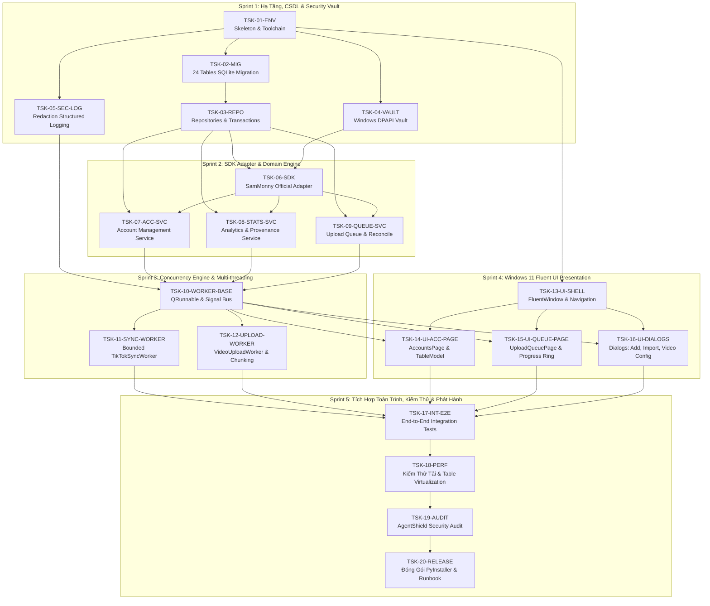

# Kế Hoạch Triển Khai & Đồ Thị Phụ Thuộc Tác Vụ (WBS & Roadmap)

Tài liệu này tổng hợp cấu trúc phân rã công việc (**Work Breakdown Structure - WBS**), đồ thị phụ thuộc tác vụ (**Directed Acyclic Graph - DAG**), và lộ trình triển khai 5 Sprint chuẩn công nghiệp.

---

## 1. Đồ Thị Phụ Thuộc Tác Vụ (WBS DAG Diagram)

---

## 2. Bảng Tổng Hợp 5 Sprint & Ma Trận Phân Bổ

| Sprint | Gói Công Việc (Epic) | Danh Sách Task | Sản Phẩm Bàn Giao Cốt Lõi |
| :--- | :--- | :--- | :--- |
| **Sprint 1** | Hạ Tầng, CSDL & Vault | `TSK-01` $\rightarrow$ `TSK-05` | CSDL 24 bảng sẵn sàng, DPAPI Vault, Logger khử nhạy cảm |
| **Sprint 2** | SDK & Nghiệp Vụ Cốt Lõi | `TSK-06` $\rightarrow$ `TSK-09` | Adapter SamMonny Official, Services Quản lý Acc, Stats, Queue |
| **Sprint 3** | Đa Luồng & Bất Đồng Bộ | `TSK-10` $\rightarrow$ `TSK-12` | Bounded ThreadPool, Worker đồng bộ, Worker upload chunking |
| **Sprint 4** | Giao Diện Windows 11 Fluent | `TSK-13` $\rightarrow$ `TSK-16` | Bảng kép, Models ảo hóa, Delegates hiển thị, Hệ thống Dialogs |
| **Sprint 5** | Tích Hợp, Tải & Đóng Gói | `TSK-17` $\rightarrow$ `TSK-20` | Test E2E, Kiểm thử 5000 profiles, Security Audit, File `.exe` |

---

## 3. Quy Ước Nghiệm Thu Tác Vụ (Definition of Done - DoD)

Mọi task kỹ thuật chỉ được xem là hoàn thành khi đáp ứng đủ 5 điều kiện:
1. **Mã nguồn hoàn chỉnh**: Có Type hints đầy đủ (`mypy --strict` pass).
2. **Kiểm thử tự động (TDD)**: Có ít nhất một unit test kiểm tra luồng chính (Happy Path) và một test kiểm tra ngoại lệ (Error Path).
3. **Tuân thủ chuẩn code**: Không có cảnh báo từ `ruff check .`.
4. **Không rò rỉ bí mật**: Không commit bất kỳ token, password hoặc file database thật nào vào repository.
5. **Cập nhật tài liệu**: Đánh dấu hoàn thành trên WBS và ghi nhật ký thay đổi.

