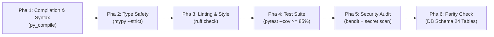

# Quy Trình Kiểm Định 6 Pha Chuẩn Công Nghiệp (6-Phase Verification Loop)

Tài liệu này định nghĩa quy trình kiểm định chất lượng tự động 6 pha bắt buộc phải chạy qua trước bất kỳ thao tác đóng gói hoặc bàn giao mã nguồn nào.

---

## 1. Bản Đồ Vòng Kiểm Định 6 Pha



---

## 2. Chi Tiết Từng Pha & Lệnh Thực Thi

### Pha 1: Kiểm Tra Cú Pháp & Biên Dịch (Compilation & Syntax)
- **Mục tiêu**: Đảm bảo toàn bộ mã nguồn không có lỗi cú pháp hoặc import vòng tròn.
- **Lệnh thực thi**:
  ```powershell
  python -m compileall app application domain infrastructure presentation -q
  ```
- **Điều kiện Pass**: Không có file nào phát sinh lỗi biên dịch (`SyntaxError`, `IndentationError`).

---

### Pha 2: An Toàn Kiểu Dữ Liệu Tĩnh (Static Type Safety)
- **Mục tiêu**: Loại bỏ hoàn toàn lỗi gán sai kiểu hoặc `AttributeError` tại runtime.
- **Lệnh thực thi**:
  ```powershell
  mypy --strict app/ application/ domain/ infrastructure/
  ```
- **Điều kiện Pass**: 0 errors. Mọi tham số và giá trị trả về của hàm đều có Type Annotation rõ ràng.

---

### Pha 3: Phong Cách Mã Nguồn & Tối Ưu (Linting & Code Style)
- **Mục tiêu**: Đảm bảo tính nhất quán của mã nguồn theo chuẩn PEP 8.
- **Lệnh thực thi**:
  ```powershell
  ruff check .
  ```
- **Điều kiện Pass**: 0 warnings, 0 errors. Không có biến thừa, import rác hoặc dead code.

---

### Pha 4: Kiểm Thử Tự Động & Độ Bao Phủ (Automated Testing & Coverage)
- **Mục tiêu**: Xác thực toàn bộ logic nghiệp vụ, transaction rollback và luồng worker.
- **Lệnh thực thi**:
  ```powershell
  pytest -v --cov=app --cov=application --cov=domain --cov=infrastructure --cov-fail-under=85
  ```
- **Điều kiện Pass**: 100% test cases Pass, tỉ lệ bao phủ code đạt tối thiểu **85%**.

---

### Pha 5: Kiểm Toán An Ninh Thông Tin (Security Audit)
- **Mục tiêu**: Bảo đảm không rò rỉ bí mật và không có lỗ hổng bảo mật chuẩn AgentShield.
- **Lệnh thực thi**:
  ```powershell
  bandit -r app/ application/ domain/ infrastructure/ -ll
  ```
- **Điều kiện Pass**: 0 High và 0 Medium severity issues. Không có chuỗi token/password bản rõ.

---

### Pha 6: Đối Soát Tính Tương Thích Lược Đồ (Schema Parity Check)
- **Mục tiêu**: Bảo đảm 24 bảng CSDL SQLite không bị sai lệch cấu trúc hay thiếu ràng buộc khóa ngoại.
- **Lệnh thực thi**:
  ```powershell
  pytest tests/integration/test_schema_parity.py -v
  ```
- **Điều kiện Pass**: Tên bảng, tên cột, khóa chính, ràng buộc UNIQUE và FOREIGN KEY khớp 100% với đặc tả kỹ thuật.

---

## 3. Script Chạy Toàn Bộ 6 Pha (Automated One-Click Script)

Bạn có thể chạy script kiểm định hợp nhất bằng PowerShell:

```powershell
# Chạy script kiểm định 6 pha
.\scripts\verify_all.ps1
```
Script sẽ dừng lại ngay lập tức nếu bất kỳ pha nào không đạt điều kiện (Fail-Fast Mechanism).

