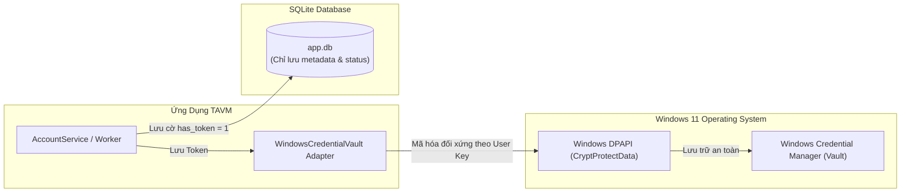

# Chính Sách An Ninh & Bảo Mật AgentShield (Security & Compliance)

Tài liệu này xác lập các tiêu chuẩn an ninh thông tin bắt buộc, cơ chế bảo vệ bí mật xác thực thông qua Windows DPAPI và bộ lọc chống rò rỉ nhật ký theo chuẩn **AgentShield Tier-1**.

---

## 1. Nguyên Tắc An Ninh Bất Khả Xâm Phạm (Non-Negotiable Rules)

1. **Tuyệt đối không lưu trữ Secret ở dạng Plaintext**:
   Mọi Access Token, Refresh Token, Client Secret, Password tài khoản không bao giờ được phép ghi trực tiếp dưới dạng văn bản rõ vào tệp SQLite `app.db`, tệp cấu hình JSON/YAML, hay tệp nhật ký `app.log`.
2. **Cô lập bí mật trong Windows Credential Manager (DPAPI)**:
   Mọi thông tin nhạy cảm bắt buộc phải lưu qua Windows DPAPI (thư viện `keyring`). Khóa mã hóa được hệ điều hành Windows tạo và gắn liền với User Account của phiên Windows hiện tại.
3. **Bộ lọc khử nhạy cảm bắt buộc (Mandatory Redaction Filter)**:
   Mọi thông điệp log và exception message phát lên giao diện người dùng đều phải đi qua `RedactionFilter` để thay thế các chuỗi bí mật bằng nhãn `***REDACTED***`.
4. **Không vượt rào chính sách nền tảng (Strict Platform Compliance)**:
   Không sử dụng API lậu, cookie scraper, endpoint giả mạo hoặc giải mã token trái phép. Chỉ sử dụng luồng ủy quyền chính thức (Official API Mode) của SDK `sammonny` 1.8.1.

---

## 2. Kiến Trúc Lưu Trữ Bí Mật Windows DPAPI Vault



### Namespace Đặt Tên:
Mỗi tài khoản được định danh trong Windows Vault theo định dạng chuẩn:
```text
TikTokUploadManager.Profile.<profile_id>
```
Nội dung lưu trữ là chuỗi JSON đã mã hóa gồm:
- `access_token`
- `refresh_token`
- `client_secret`
- `expires_at`

---

## 3. Quy Tắc Bộ Lọc Khử Nhạy Cảm (Redaction Filter Rules)

Bộ lọc `RedactionFilter` trong `infrastructure/logging/redaction_logger.py` áp dụng các mẫu biểu thức chính quy (Regex) sau để phát hiện và che giấu dữ liệu nhạy cảm:

| Nhóm Dữ Liệu | Mẫu Regex Nhận Diện | Hành Động Che Mờ |
| :--- | :--- | :--- |
| **Bearer / OAuth Tokens** | `(?i)bearer\s+[a-zA-Z0-9_\-\.]{15,}` | Thay bằng `Bearer ***REDACTED***` |
| **JWT Tokens** | `ey[a-zA-Z0-9_\-]{10,}\.ey[a-zA-Z0-9_\-]{10,}\.[a-zA-Z0-9_\-]{10,}` | Thay bằng `***REDACTED_JWT***` |
| **Mật Khẩu & Bí Mật** | `(?i)(password|secret|totp_secret)\s*[:=]\s*['"][^'"]+['"]` | Thay bằng `\1="***REDACTED***"` |
| **TikTok Cookie Identifiers** | `(?i)(sessionid|sid_guard|sid_tt)\s*=\s*[^;\s&]+` | Thay bằng `\1=***REDACTED***` |

---

## 4. Ứng Phó Sự Cố Khi Nghi Ngờ Rò Rỉ Bí Mật (Incident Response)

Nếu phát hiện bất kỳ dấu hiệu rò rỉ token hoặc secret:
1. **Thu hồi Token ngay lập tức**: Xóa entry tương ứng trong Windows Vault bằng lệnh:
   ```powershell
   cmdkey /delete:TikTokUploadManager.Profile.<id>
   ```
2. **Hủy phiên từ xa**: Hướng dẫn người dùng đăng nhập tài khoản TikTok trên trình duyệt và thu hồi quyền truy cập của ứng dụng trong phần Cài đặt quyền riêng tư.
3. **Xóa nhật ký**: Xóa toàn bộ file log trong thư mục `logs/` và khởi động lại ứng dụng.

